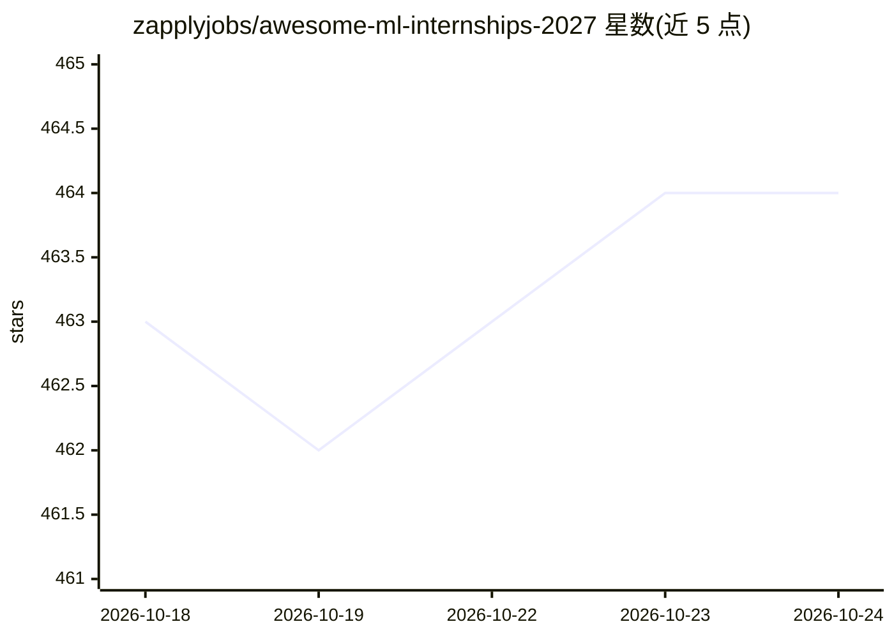

# zapplyjobs/awesome-ml-internships-2027

⭐ 464 · 推送 2026-10-23 · [GitHub](https://github.com/zapplyjobs/awesome-ml-internships-2027) · [官网](https://softwarejobs.dev/?ref=gh-awesome-ml-internships) · 组织维护

**面向学生的 AI/ML 实习职位聚合清单（Zapply 管道刷新）**

由 Zapply 维护的 2027 届 AI、机器学习与数据科学实习职位聚合清单：职位通过 Zapply job pipeline 抓取并声称每 10 分钟刷新，按公司、职位、地点、发布时间与是否提供签证赞助列表呈现，另含数据科学与分析类职位。README 同时推广 Zapply 的 Chrome 自动填表扩展、求职看板、多简历账户与申请进度跟踪功能，并提供 Discord 与 LinkedIn 社区入口。无安装步骤，条目以表格形式供浏览与跳转申请。

## 筛选速览

| 维度 | 判定 | 备注 |
|---|---|---|
| AI 角色 | `ai-knowledge` | 知识聚合/清单类 |
| 许可风险 | `none` | — |
| 部署形态 | `None` |  |
| 模型依赖 | — | README 未给出锁定关系 |
| 硬件要求 | — | 无带数字的原话,不猜 |
| 安装摩擦 | `medium` | 含编译或系统依赖之一 |
| 成熟度 | — | 结构信号不足 |

## 能力要点

- AI/ML 与数据科学实习职位表格化聚合，标注签证赞助信息
- 声称每 10 分钟经 Zapply job pipeline 刷新
- 附带 Zapply Chrome 自动填表扩展与求职看板入口

## 适用场景

- 查找 2027 年 AI/ML 实习并按签证赞助筛选
- 了解近期（两周内）新发布的 AI 相关实习岗位
- 配合 Zapply 扩展加速投递流程

## 场景标签

`精选清单` · 领域:学习与行业

## 证据(README 行号)

> L5:  🚀 Live AI, machine learning, and data science internships for students, refreshed through the Zapply job pipeline.
> L10:  Updated every 10 minutes

## 星数曲线

2026-10-18 463 → 2026-10-24 464（+1）

---
*卡片 v1 · prompt 1.4 · 生成 2026-10-21 · 置信度 high · 依据 README sha `4d3c0062999d` · [字段定义](../../DATASET.md)*
