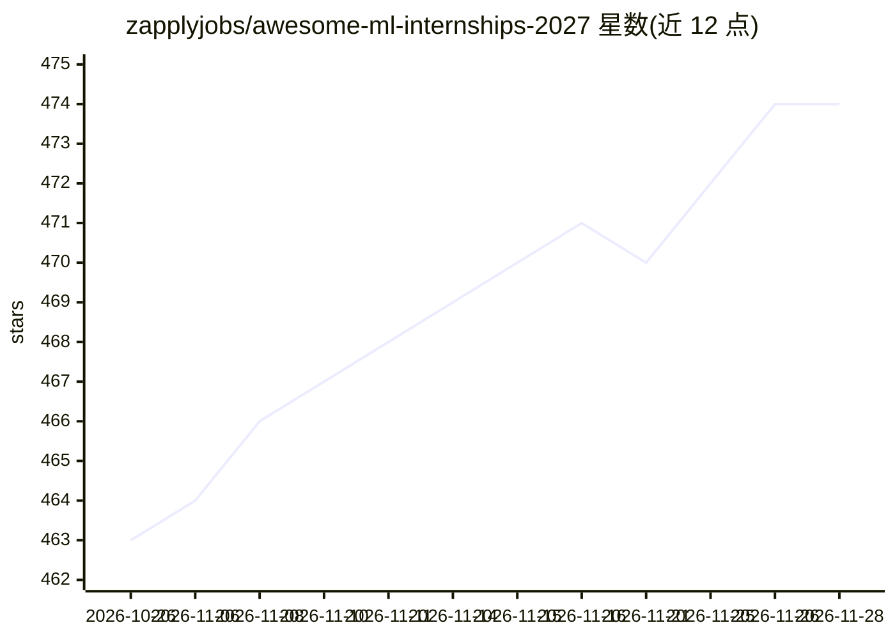

# zapplyjobs/awesome-ml-internships-2027

⭐ 474 · 推送 2026-11-27 · [GitHub](https://github.com/zapplyjobs/awesome-ml-internships-2027) · [官网](https://softwarejobs.dev/?ref=gh-awesome-ml-internships) · 组织维护

**面向学生的 AI/ML/数据科学实习岗位聚合清单，定期刷新**

由 Zapply 招聘管道刷新的 2027 年 AI、机器学习与数据科学实习岗位清单，主体为公司-职位-地点-签证赞助-申请链接的表格列表，按 ML/AI 工程与数据科学等类别分组，声明每 10 分钟更新。同时推广 Zapply 网站、Chrome 自动填表扩展、职位板、Discord 与 LinkedIn 社区。仅罗列岗位信息，不涉及模型或算法内容。

## 筛选速览

| 维度 | 判定 | 备注 |
|---|---|---|
| AI 角色 | `ai-knowledge` | 知识聚合/清单类 |
| 许可风险 | `none` | — |
| 部署形态 | `None` |  |
| 模型依赖 | — | README 未给出锁定关系 |
| 硬件要求 | — | 无带数字的原话,不猜 |
| 安装摩擦 | `low` | 无编译、无系统依赖或容器化 |
| 成熟度 | — | 结构信号不足 |

## 能力要点

- 按 ML/AI 工程、数据科学分类的实习岗位表格，含签证赞助标注
- 声明岗位列表每 10 分钟通过 Zapply 管道刷新
- 配套 Zapply 网站与自动填写申请的 Chrome 扩展

## 适用场景

- 查找 2027 年 AI/ML 方向的实习与 Co-op 岗位
- 筛选提供签证赞助的美国实习职位
- 关注大厂与研究所的 AI 研究类实习 openings

## 场景标签

`精选清单` · 领域:学习与行业

## 证据(README 行号)

> L3: # AI & Machine Learning Internships 2027
> L5:  🚀 Live AI, machine learning, and data science internships for students, refreshed through the Zapply job pipeline.
> L41: |Company|Role|Location|Posted|Visa|**Apply**|

## 星数曲线

2026-10-26 463 → 2026-11-28 474（+11）

---
*卡片 v1 · prompt 1.4 · 生成 2026-11-28 · 置信度 high · 依据 README sha `261d375661f5` · [字段定义](../../DATASET.md)*
