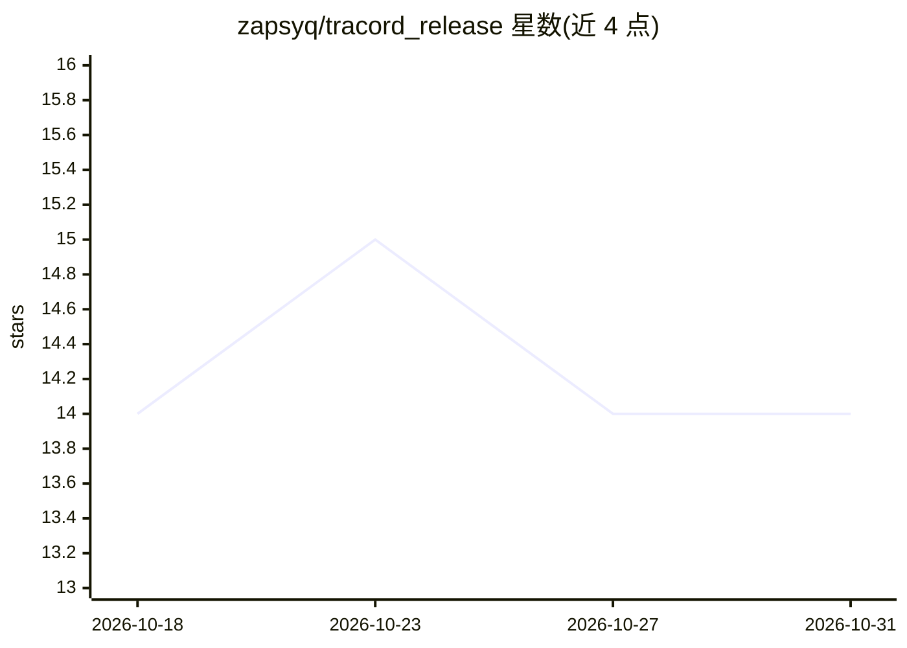

# zapsyq/tracord_release

⭐ 14 · Python · Apache-2.0 · 推送 2026-10-16 · [GitHub](https://github.com/zapsyq/tracord_release) · 个人维护 · 中文 README

**本地小模型多智能体的移动端旅行规划助手**

Flutter 移动端 + FastAPI 后端的旅行应用：地图点亮去过城市、一句话记账、攻略知识库问答，核心是 AI 行程规划——小模型槽位填充后交给自研确定性 DFS 引擎，基于真实景点/车次/航班数据生成按天时间轴行程与逐项费用。多智能体采用 LangChain/LangGraph supervisor 架构，依赖两个 llama.cpp 本地模型服务（Qwen3.5-0.8B 对话、m3e 向量），需 MySQL/Redis 及高德、天地图等第三方 key，从源码构建运行。

## 筛选速览

| 维度 | 判定 | 备注 |
|---|---|---|
| AI 角色 | `ai-native` | 本体是模型或模型工具 |
| 许可风险 | `permissive` | Apache-2.0 |
| 部署形态 | `desktop` | 安装包/桌面程序 |
| 模型依赖 | local-ok | 支持本地模型 |
| 硬件要求 | — | 无带数字的原话,不猜 |
| 安装摩擦 | `low` | 无编译、无系统依赖或容器化 |
| 成熟度 | — | 结构信号不足 |

## 能力要点

- 小模型槽位填充 + 确定性 DFS 规划引擎（真实车次/景点/预算数据）
- LangGraph 多智能体 supervisor 意图路由，Harness 确定性代码验收模型输出
- 本地攻略知识库向量检索（Chroma + m3e，支持 txt/pdf/csv 导入增量更新）
- 提供 LLaMA-Factory LoRA 微调流程与训练数据

## 适用场景

- 一句话生成按天可执行行程与费用明细
- 旅行中一句话记账并按城市归档查账
- 导入攻略文档做本地知识库问答
- 长按地图点亮去过的城市建立旅行档案

## 场景标签

`文档问答` `微调` · 领域:知识与检索

## 证据(README 行号)

> L11: 在地图上点亮去过的城市、一句话记账；AI 助手听懂一句"上海去杭州玩4天，预算3000"，
> L65: |智能体|LangChain + LangGraph，多智能体 supervisor|
> L121: llama-server -m qwen3.5-0.8b.gguf --port 8080

## 星数曲线

2026-10-18 14 → 2026-10-31 14（+0）

---
*卡片 v1 · prompt 1.4 · 生成 2026-10-31 · 置信度 high · 依据 README sha `45df6b822d15` · [字段定义](../../DATASET.md)*
