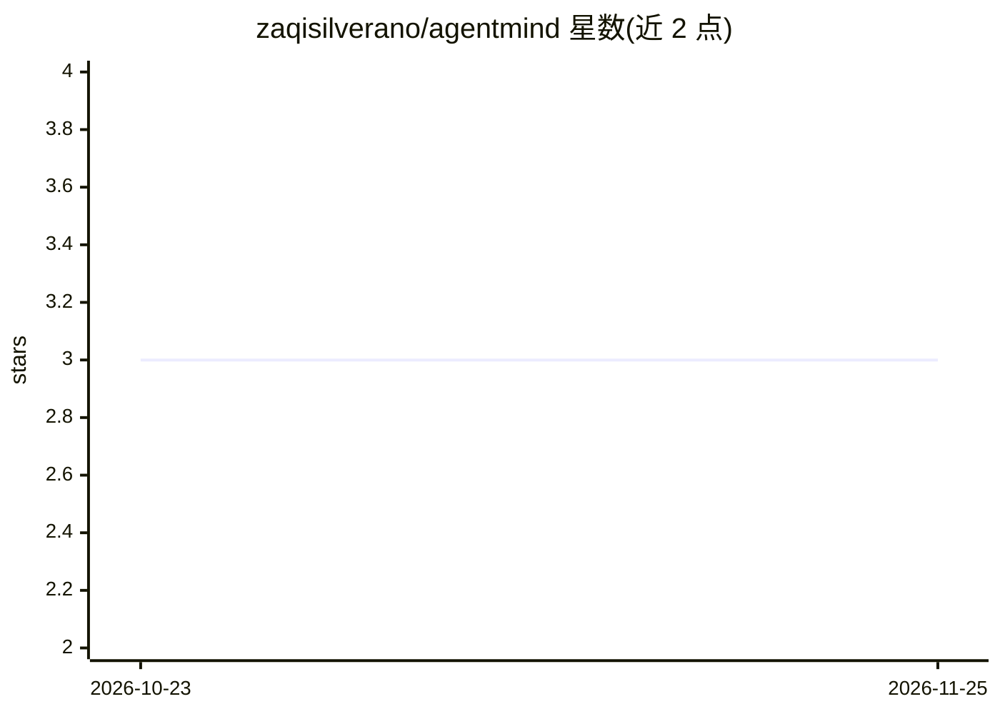

# zaqisilverano/agentmind

⭐ 3 · TypeScript · MIT · 推送 2026-10-18 · [GitHub](https://github.com/zaqisilverano/agentmind) · [官网](https://agentmind.zaqi.build) · 个人维护

**输入一个想法，五个 agent 协作生成可编辑导出的 3D 思维图**

Web 端头脑风暴工具：用户输入想法后由 LLM 拆解为分支与子想法的 3D 地图，Researcher、Builder、Customer、Skeptic、Strategist 五个 agent 轮次扩展节点与连接，Strategist 输出关键结论与路径。支持三种布局、三套主题，节点可加注或让 agent 单独扩展，导出为 Markdown、JSON 或独立 3D 页面。默认调用 K2 Horizon 或任意 OpenAI 兼容端点，无 API key 时走内置离线回退；以匿名 cookie 保存数据，无需账号。部署依赖 Node 24、pnpm、Docker 与 Postgres。

## 筛选速览

| 维度 | 判定 | 备注 |
|---|---|---|
| AI 角色 | `ai-native` | 本体是模型或模型工具 |
| 许可风险 | `permissive` | MIT |
| 部署形态 | `self-host` | docker 或自建部署 |
| 模型依赖 | local-ok | 支持本地模型 |
| 硬件要求 | — | 无带数字的原话,不猜 |
| 安装摩擦 | `low` | 无编译、无系统依赖或容器化 |
| 成熟度 | — | 结构信号不足 |

## 能力要点

- 五个角色 agent（Researcher/Builder/Customer/Skeptic/Strategist）按 plan→travel→think→spawn→link→done 轮次扩展地图
- 默认 K2 Horizon，可配置任意 OpenAI 兼容端点或本地 Ollama；无 key 时离线回退
- 三种 3D 布局（Constellation/Orbit/Terrain）与三种主题，导出 Markdown/JSON/独立 3D 页面
- 匿名 httpOnly cookie 身份，无账号；限速、 brains/节点数上限内置

## 适用场景

- 输入一个创业或项目想法，让多 agent 从问题、机制、价值、风险等角度展开成地图
- 探索性地把零散灵感组织成可视化的分支结构并导出成文档
- 在手机或离线环境下使用回退模式体验头脑风暴流程

## 场景标签

`多智能体` · 领域:Agent 开发

## 证据(README 行号)

> L17: Type an idea and press **Run agents**. agentmind breaks it into a 3D map of branches and sub-ideas, then five agent
> L107:  idea text ──► POST /api/llm/map ──► LLM (or local fallback)
> L111: - **Create a brain.** The idea goes to `POST /api/llm/map`. The reply is validated with Zod. On failure the route 

## 星数曲线

2026-10-23 3 → 2026-11-25 3（+0）

---
*卡片 v1 · prompt 1.4 · 生成 2026-11-21 · 置信度 mid · 依据 README sha `60c88edbe07f` · [字段定义](../../DATASET.md)*
