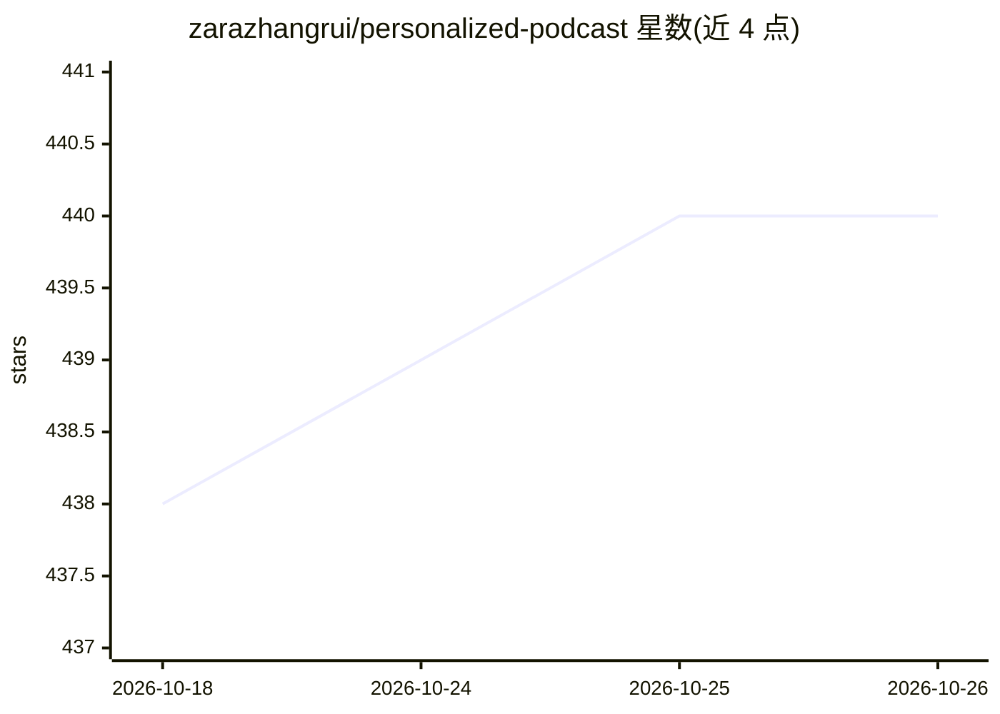

# zarazhangrui/personalized-podcast

⭐ 440 · Python · 推送 2026-04-08 · [GitHub](https://github.com/zarazhangrui/personalized-podcast) · [官网](https://x.com/zarazhangrui) · 个人维护

**把任意内容生成为双主播 AI 播客的编码代理技能**

面向 Claude Code 等支持技能的编码代理的技能包：输入文本、文件或 URL，由代理撰写双主播（Alex/Sam）播客脚本，调用 Fish Audio 文本转语音（免费层可用）生成 MP3，用 pydub+ffmpeg 拼接音频，可选经 GitHub Pages 自动生成 RSS feed 供 Apple Podcasts、Spotify 等订阅。脚本提示词、声音、节目性格均可在配置文件中修改，整个流程在本地代理中运行，无独立后端。需要 Python 3.10+ 与 ffmpeg。

## 筛选速览

| 维度 | 判定 | 备注 |
|---|---|---|
| AI 角色 | `ai-native` | 本体是模型或模型工具 |
| 许可风险 | `none` | — |
| 部署形态 | `None` |  |
| 模型依赖 | — | README 未给出锁定关系 |
| 硬件要求 | — | 无带数字的原话,不猜 |
| 安装摩擦 | `medium` | 含编译或系统依赖之一 |
| 成熟度 | — | 结构信号不足 |

## 能力要点

- 由编码代理直接撰写脚本，无需单独 LLM API 调用
- Fish Audio 文本转语音（2M+ 声音，含免费层）
- 可选 GitHub Pages RSS feed，自动推送新节目
- PROMPT.md 可定制辩论/采访/独白等节目格式

## 适用场景

- 把 newsletter、论文、会议纪要转成音频在路上听
- 让两位主播分析自己的简历或日记做自我审视
- 按自定义声音与风格生成固定格式的播客节目

## 场景标签

`语音合成` `AI 写作` · 领域:内容生成

## 证据(README 行号)

> L7: A coding agent skill that turns any content into a two-host podcast episode. Paste in text, point it at files, drop 
> L29: That's it. On first run, Claude sets up the Python environment, installs dependencies, and asks you for a free Fish

## 星数曲线

2026-10-18 438 → 2026-10-26 440（+2）

---
*卡片 v1 · prompt 1.4 · 生成 2026-10-21 · 置信度 high · 依据 README sha `60c386c40c8b` · [字段定义](../../DATASET.md)*
