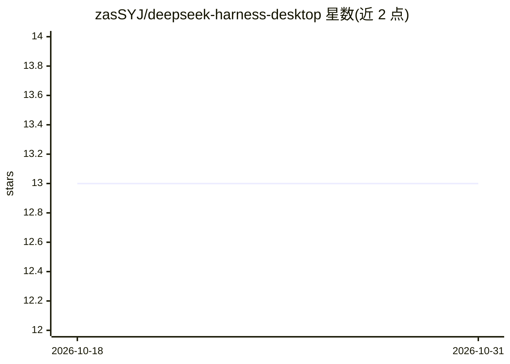

# zasSYJ/deepseek-harness-desktop

⭐ 13 · JavaScript · MIT · 推送 2026-09-19 · [GitHub](https://github.com/zasSYJ/deepseek-harness-desktop) · [官网](https://github.com/deepseek-ai/deepseek-harness) · 个人维护 · 中文 README

**把 DeepSeek Harness (dsh) 打包成 Windows 桌面应用的非官方封装**

非官方社区项目，将 DeepSeek AI 开源的 DeepSeek Harness (dsh) 封装为 Electron Windows 桌面应用：内置 Node 运行时与官方 Harness 本体，双击即用，无需安装 Node.js 或命令行。默认接入官方多模态模型支持识图，提供系统托盘、单实例、运行日志、含国内镜像回退的自动增量更新，并离线内置插件市场与技能库。Releases 提供 exe 安装版与免安装版，也可用 Node.js 18+ 与 pnpm 从源码构建。声明与 DeepSeek AI 无隶属关系，且 Harness 处于开发者预览阶段，可能包含破坏兼容性的变更。

## 筛选速览

| 维度 | 判定 | 备注 |
|---|---|---|
| AI 角色 | `ai-ecosystem` | LLM/agent 周边工具 |
| 许可风险 | `permissive` | MIT |
| 部署形态 | `desktop` | 安装包/桌面程序 |
| 模型依赖 | locked-api |  |
| 硬件要求 | — | 无带数字的原话,不猜 |
| 安装摩擦 | `low` | 无编译、无系统依赖或容器化 |
| 成熟度 | `idea` | |

## 能力要点

- 内置 Node 运行时与官方 dsh 本体，双击即用无需安装 Node.js
- 默认接入多模态模型，图片识别与看图对话可用
- 自动增量更新，GitHub 失败时自动切换国内镜像
- 安装包内置插件市场与技能库，首次启动离线就绪

## 适用场景

- 在 Windows 上免命令行使用 DeepSeek Harness
- 通过托盘后台运行保持任务不中断
- 在插件市场浏览并一键安装社区插件与技能

## 场景标签

`Agent 框架` · 领域:Agent 开发

## 证据(README 行号)

> L3: > 非官方社区封装。把 DeepSeek AI 开源的 DeepSeek Harness (dsh) 打包成 Windows 桌面应用，双击即用。
> L13: - 内置 Node 运行时与官方 DeepSeek Harness 本体（与 `npx @deepseek-ai/dsh web` 完全相同的官方界面）

## 星数曲线

2026-10-18 13 → 2026-10-31 13（+0）

---
*卡片 v1 · prompt 1.4 · 生成 2026-10-31 · 置信度 mid · 依据 README sha `61884b8649bc` · [字段定义](../../DATASET.md)*
