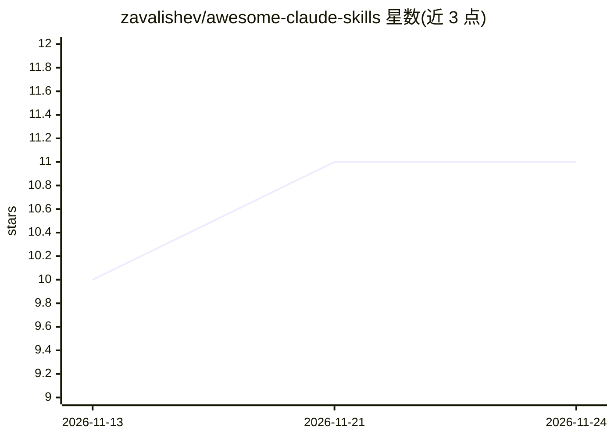

# zavalishev/awesome-claude-skills

⭐ 11 · 推送 2026-02-22 · [GitHub](https://github.com/zavalishev/awesome-claude-skills) · 个人维护

**面向 Claude Code 开发者的 81 条 AI 技能策展清单**

策展型技能库：从 5 个开源仓库（anthropics/skills、obra/superpowers、trailofbits/skills 等）去重收录 81 个 Claude Code 技能，按开发流程、代码审查、安全、API/后端、前端、DevOps、数据库等 14 个类别组织。技能以 Markdown 指令文件形式提供，通过复制到项目 .claude/commands/ 目录或引用到 CLAUDE.md 使用。各技能保留原来源仓库的许可证。

## 筛选速览

| 维度 | 判定 | 备注 |
|---|---|---|
| AI 角色 | `ai-knowledge` | 知识聚合/清单类 |
| 许可风险 | `none` | — |
| 部署形态 | `None` |  |
| 模型依赖 | — | README 未给出锁定关系 |
| 硬件要求 | — | 无带数字的原话,不猜 |
| 安装摩擦 | `low` | 无编译、无系统依赖或容器化 |
| 成熟度 | — | 结构信号不足 |

## 能力要点

- 81 个技能来自 5 个开源仓库，按 14 个类别组织
- 复制到 .claude/commands/ 或引用 CLAUDE.md 即可使用
- 涵盖 TDD、安全审计、DevOps、文档生成等开发场景
- 提供 frontmatter 格式与 PR 贡献流程

## 适用场景

- 为 Claude Code 项目按需挑选 TDD/调试/代码审查技能
- 为安全审计查找 Semgrep 相关技能与规则编写方法
- 查找 React/FastAPI/PostgreSQL 等专项开发提示模板

## 场景标签

`精选清单` `提示工程` · 领域:Agent 开发

## 证据(README 行号)

> L3: Курируемая библиотека **81 скилла** для Claude Code — расширяй возможности AI-ассистента для разработки.
> L44: ## 📂 Каталог скиллов

## 星数曲线

2026-11-13 10 → 2026-11-24 11（+1）

---
*卡片 v1 · prompt 1.4 · 生成 2026-11-19 · 置信度 high · 依据 README sha `c6179adc85d8` · [字段定义](../../DATASET.md)*
