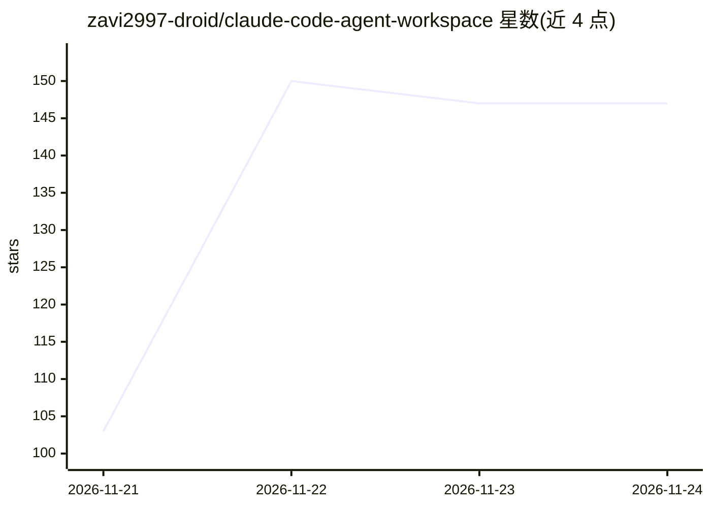

# zavi2997-droid/claude-code-agent-workspace

⭐ 147 · HTML · 推送 2026-11-22 · [GitHub](https://github.com/zavi2997-droid/claude-code-agent-workspace) · 个人维护

**为 Claude Code agent 提供隔离工作区与编排的 Windows CLI**

命令行工具，用于为 Claude Code agent 搭建和管理隔离工作区：按 agent 生成目录脚手架、分层合并配置文件，提供会话启动与销毁的生命周期命令。它是 Claude Code CLI 之上的薄编排层，不实现模型或 agent 运行时，不管理模型访问、凭据或网络策略，要求已有可用的 Claude Code 安装。支持声明式任务定义与拓扑排序执行、结构化运行记录、环境变量白名单过滤，非交互式设计便于脚本与 CI 调用。仅支持 Windows 10/11 与 PowerShell 5.1+。

## 筛选速览

| 维度 | 判定 | 备注 |
|---|---|---|
| AI 角色 | `ai-ecosystem` | LLM/agent 周边工具 |
| 许可风险 | `none` | — |
| 部署形态 | `None` |  |
| 模型依赖 | — | README 未给出锁定关系 |
| 硬件要求 | — | 无带数字的原话,不猜 |
| 安装摩擦 | `low` | 无编译、无系统依赖或容器化 |
| 成熟度 | — | 结构信号不足 |

## 能力要点

- 每项目隔离工作区：配置、任务定义与运行产物自包含
- 声明式任务定义与拓扑排序，检测循环依赖
- 环境变量白名单过滤，shell 密钥默认不继承
- 单二进制运行，无后台进程与监听端口

## 适用场景

- 让 agent 在隔离工作区中重构特定模块，避免触碰无关目录
- 夜间批量排队执行多个维护任务而无需逐步监督
- 恢复或回放先前会话以调试运行过程

## 场景标签

`Agent 框架` · 领域:Agent 开发

## 证据(README 行号)

> L12: `claude-code-agent-workspace` is a command-line tool for provisioning and managing isolated workspaces for Claude C
> L41: Claude Code Agent Workspace is a thin orchestration layer over the Claude Code CLI. It does not implement a model, 

## 星数曲线

2026-11-21 103 → 2026-11-24 147（+44）

---
*卡片 v1 · prompt 1.4 · 生成 2026-11-21 · 置信度 high · 依据 README sha `1c6d3d141085` · [字段定义](../../DATASET.md)*
