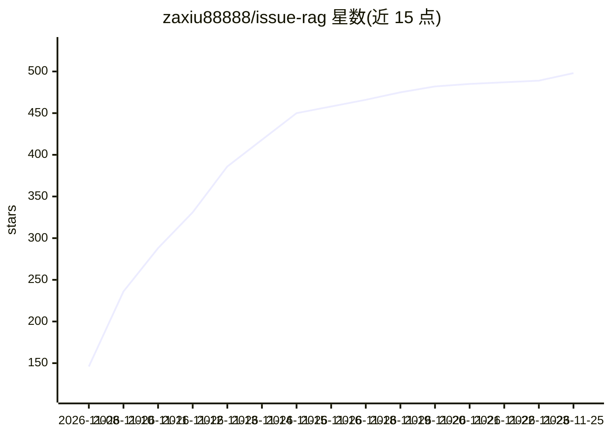

# zaxiu88888/issue-rag

⭐ 498 · Python · MIT · 推送 2026-11-04 · [GitHub](https://github.com/zaxiu88888/issue-rag) · 个人维护 · 中文 README

**面向 GitHub issues 的 RAG 问答系统，含人工复核评测集与判分器审计**

对真实开源仓库 issue tracker 做检索增强问答的系统与研究项目：默认在 vitejs/vite 语料（5,473 篇文档）上，用 95 条从维护者回答中挖掘并人工复核的评测集，比较闭卷、BM25、稠密检索、混合与 rerank 五种配置；用 LLM-as-judge 判分，并对判分器做四轴审计（换判分模型、同模型重跑、换 rubric、30 条人工盲评，一致率 70.0%）。报告增益区间而非单点数字，并指出检索会抬高编造率、四种检索配置彼此不可区分、检索仅支持英文等限制。生成与判分模型支持 deepseek/openai/siliconflow/ollama 等本地与远程后端。

## 筛选速览

| 维度 | 判定 | 备注 |
|---|---|---|
| AI 角色 | `ai-native` | 本体是模型或模型工具 |
| 许可风险 | `permissive` | MIT |
| 部署形态 | `library` | 以包/库形式分发 |
| 模型依赖 | local-ok | 支持本地模型 |
| 硬件要求 | — | 无带数字的原话,不猜 |
| 安装摩擦 | `low` | 无编译、无系统依赖或容器化 |
| 成熟度 | — | 结构信号不足 |

## 能力要点

- 评测集从真实 issue 与维护者回答挖掘并经人工复核（95 条）
- 对 LLM 判分器做四轴审计：换模型、重跑噪声、换 rubric、人工盲评
- 检索指标以 leave-one-issue-out 双重报告，编造回答判为 incorrect
- 支持 local/deepseek/openai/siliconflow/ollama 及任意 OpenAI 兼容端点

## 适用场景

- 研究检索增强对快速迭代库问答的实际增益
- 复用其评测流程审计自己仓库的 RAG 或 LLM 判分器
- 考察 LLM-as-judge 的偏差与噪声量化方法

## 场景标签

`RAG` `模型评测` · 领域:评测与运维

## 证据(README 行号)

> L9: 面向真实开源仓库 issue tracker 的检索增强问答系统（RAG），核心不是「能问答」，而是**把评测做扎实，并且审计自己的评分器**。
> L11: 在 `vitejs/vite` 上，用 **95 条人工复核**的问题测得（生成与判分 `deepseek-chat`，语料 5,473 篇）：
> L155: `--provider` accepts `local`, `deepseek`, `openai`, `siliconflow`, or `ollama`,

## 星数曲线

2026-11-08 146 → 2026-11-25 498（+352）

---
*卡片 v1 · prompt 1.4 · 生成 2026-11-17 · 置信度 high · 依据 README sha `a870a5489f08` · [字段定义](../../DATASET.md)*
