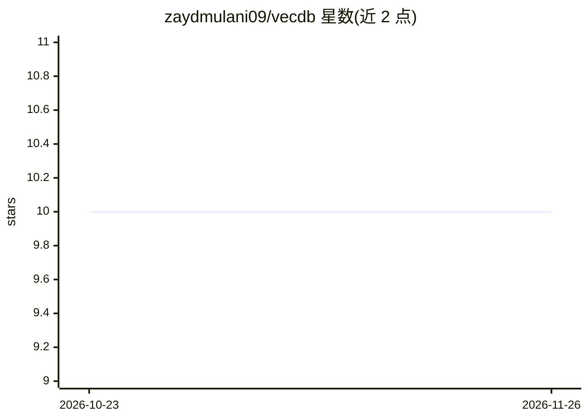

# zaydmulani09/vecdb

⭐ 10 · Rust · MIT · 推送 2026-09-23 · [GitHub](https://github.com/zaydmulani09/vecdb) · 个人维护

**面向 Rust 应用的嵌入式向量数据库库：进程内完成向量检索**

以库形式链接进应用的向量数据库，无服务器、无守护进程、无 Docker，通过 cargo add 引入后指向一个文件即可进程内查询。磁盘上存储 float32 向量与 JSON 元数据，提供 HNSW 稠密检索、内置 BM25 稀疏检索、混合检索与元数据谓词下推过滤，支持 int8/1-bit 量化与写前日志崩溃恢复。HNSW 索引构建为单机单线程，README 明确给出 100 万向量约 2.5 小时的构建时长预期。可选 vecdb-api crate 提供 REST 服务封装，但定位为次要使用方式。

## 筛选速览

| 维度 | 判定 | 备注 |
|---|---|---|
| AI 角色 | `ai-native` | 本体是模型或模型工具 |
| 许可风险 | `permissive` | MIT |
| 部署形态 | `library` | 以包/库形式分发 |
| 模型依赖 | — | README 未给出锁定关系 |
| 硬件要求 | — | 无带数字的原话,不猜 |
| 安装摩擦 | `low` | 无编译、无系统依赖或容器化 |
| 成熟度 | — | 结构信号不足 |

## 能力要点

- 嵌入式库形态：cargo add 后进程内查询，无网络依赖
- 稠密（HNSW）+ 稀疏（BM25 内置倒排索引）+ 混合 + 过滤检索
- int8（约4×）或 1-bit 二进制（约32×）量化，SIMD 距离核
- 写前日志、崩溃恢复、重开持久化

## 适用场景

- 在 Rust 应用中嵌入本地向量检索，不部署数据库服务
- 本地优先场景下存储与检索带元数据的向量
- 为 RAG 流程提供进程内的稠密/稀疏/混合检索

## 场景标签

`向量数据库` · 领域:知识与检索

## 证据(README 行号)

> L7: **An embeddable vector database in Rust. No server, no daemon, no docker — `cargo add`, point it at a file, query in
> L9: Think SQLite, for vector search. vecdb is a library you link into your app, not a service you run beside it. It stor
> L52: - **Dense search** — HNSW (via instant-distance), cosine / euclidean / dot metrics, SIMD distance kernels

## 星数曲线

2026-10-23 10 → 2026-11-26 10（+0）

---
*卡片 v1 · prompt 1.4 · 生成 2026-11-19 · 置信度 high · 依据 README sha `6c517e716444` · [字段定义](../../DATASET.md)*
