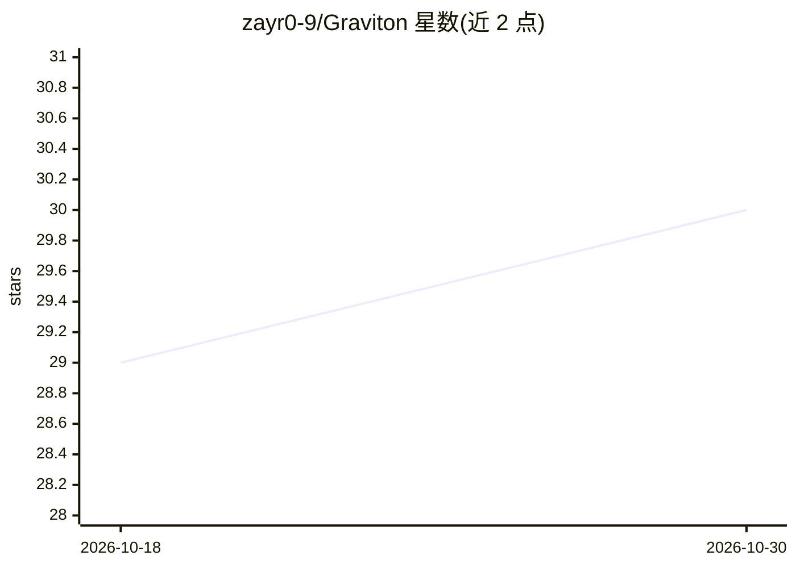

# zayr0-9/Graviton

⭐ 30 · TypeScript · AGPL-3.0 · 推送 2026-10-28 · [GitHub](https://github.com/zayr0-9/Graviton) · [官网](https://yggchat.com/) · 个人维护

**本地优先 AI 工作区与 agent harness：树状对话+工具调用**

基于 Electron + React + 内嵌本地服务器的本地优先 AI 工作区：支持读写文件、代码搜索、执行 shell 命令与调用工具；以树状分支对话组织工作流（每次编辑为分支，可搜索全部历史），工具可返回 HTML 在聊天内沙箱 iframe 渲染为‘AI 应用’；桌面模式支持持久后台 agent，内置自定义工具、MCP 集成与技能安装，并提供 VS Code 扩展。开发需自行构建，采用 AGPL-3.0 许可。

## 筛选速览

| 维度 | 判定 | 备注 |
|---|---|---|
| AI 角色 | `ai-native` | 本体是模型或模型工具 |
| 许可风险 | `viral` | AGPL-3.0 |
| 部署形态 | `library` | 以包/库形式分发 |
| 模型依赖 | — | README 未给出锁定关系 |
| 硬件要求 | — | 无带数字的原话,不猜 |
| 安装摩擦 | `low` | 无编译、无系统依赖或容器化 |
| 成熟度 | — | 结构信号不足 |

## 能力要点

- 分支树状对话（Heimdall tree），每次编辑为分支
- 工具可返回 HTML 在沙箱 iframe 中渲染为 AI 应用
- 持久后台 agent 循环（带权限门控）
- 自定义工具 + MCP 集成 + 可安装技能包

## 适用场景

- 以非线性的多分支对话进行探索式编程与问题求解
- 在聊天中运行返回仪表盘、编辑器等 HTML 界面的工具
- 通过后台 agent 执行排队任务并管理文件、运行命令

## 场景标签

`AI 助手` `Agent 框架` `聊天机器人` · 领域:Agent 开发

## 证据(README 行号)

> L5: Graviton is a **local-first AI workspace** and an **agent harness**:
> L6: it can **read & write files**, **search code**, **run shell commands**, and **invoke tools**—while also supporting *

## 星数曲线

2026-10-18 29 → 2026-10-30 30（+1）

---
*卡片 v1 · prompt 1.4 · 生成 2026-10-26 · 置信度 high · 依据 README sha `373a016ac153` · [字段定义](../../DATASET.md)*
