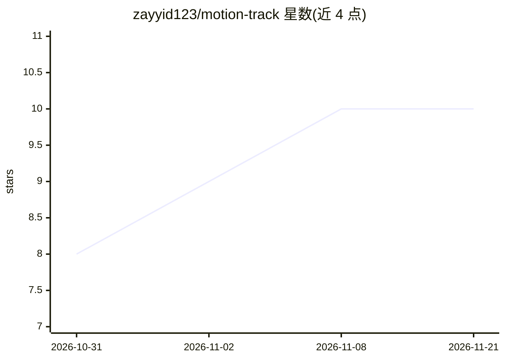

# zayyid123/motion-track

⭐ 10 · TypeScript · MIT · 推送 2026-10-29 · [GitHub](https://github.com/zayyid123/motion-track) · [官网](https://motion-track.repomaniac.com) · 个人维护

**浏览器端的等距贴纸动画工作室：可视化编辑与 GIF/MP4/MOV 导出**

基于 Next.js 16 + React 19 的浏览器端动画等距贴纸制作工具：分层绘制贴纸、多轨时间线编排 21 种运动预设、滚动循环动画，并在本地导出 GIF、MP4 与带 alpha 的 ProRes 4444 MOV（经 ffmpeg.wasm 与 WebCodecs，无服务器、不上传数据）。内置 24 个手绘贴纸库，另含混合 AI 助手：聊天描述或附图后返回经校验的动作并作为单步撤销应用，默认浏览器直连 OpenAI 兼容端点，可选经 /api/ai-proxy 中继。需 Node.js 22+ 自行部署运行。

## 筛选速览

| 维度 | 判定 | 备注 |
|---|---|---|
| AI 角色 | `ai-enhanced` | 去掉 AI 部分产品仍成立 |
| 许可风险 | `permissive` | MIT |
| 部署形态 | `library` | 以包/库形式分发 |
| 模型依赖 | — | README 未给出锁定关系 |
| 硬件要求 | — | 无带数字的原话,不猜 |
| 安装摩擦 | `medium` | 含编译或系统依赖之一 |
| 成熟度 | — | 结构信号不足 |

## 能力要点

- 多轨时间线编辑器：21 种运动预设、分组容器、逐层描边与六套主题
- 客户端导出 GIF/MP4/ProRes 4444 MOV（alpha），循环补齐至至少 6 秒
- AI 助手返回校验后动作并以单步撤销应用，支持贴图重建
- 完全本地计算：无账号、无上传，API key 不离开浏览器标签页

## 适用场景

- 制作循环播放的等距风格动图贴纸并导出为 GIF/MP4
- 通过聊天描述生成符合风格的贴纸并套用运动预设
- 在本地离线环境下编辑与导出透明背景 MOV 视频

## 场景标签

 · 领域:设计/动画工具

## 证据(README 行号)

> L12: **Motion-Track** is a browser-based studio for building animated isometric slab
> L73: - **Hybrid AI assistant** with direct browser transport by default and an
> L75: - **AI auto-apply** — the assistant returns validated actions (layers, colors,

## 星数曲线

2026-10-31 8 → 2026-11-21 10（+2）

---
*卡片 v1 · prompt 1.4 · 生成 2026-11-19 · 置信度 high · 依据 README sha `425b06c22a0e` · [字段定义](../../DATASET.md)*
