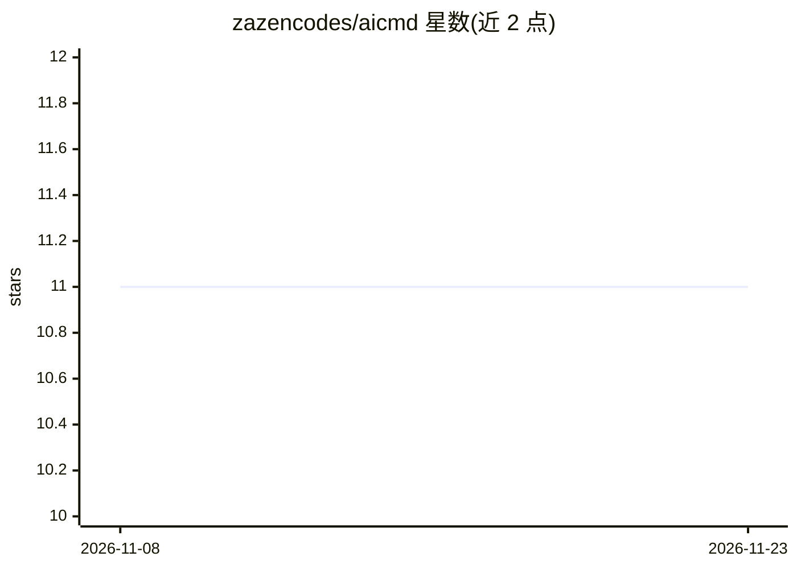

# zazencodes/aicmd

⭐ 11 · Go · MIT · 推送 2026-11-22 · [GitHub](https://github.com/zazencodes/aicmd) · [官网](https://zazencodes.com/) · 个人维护

**开发者在终端里把自然语言转成 shell 命令的 CLI 工具**

Go 编写的命令行工具：用户输入命令描述，工具将其注入提示模板后交由底层 LLM，生成的 shell 命令插入终端供用户审阅、修改后执行；输出重定向（如管道）时改为直接打印。支持三类接入：已付费的 CLI Agent（Codex/Claude Code/Antigravity）、直接调用 API（通过官方 OpenAI Go SDK，需环境变量凭证）、经 Ollama/llama.cpp 的本地模型。支持 macOS/Linux，安装脚本一行安装，配置文件为 ~/.config/aicmd.toml，可复制到剪贴板、可覆盖模型 spec。

## 筛选速览

| 维度 | 判定 | 备注 |
|---|---|---|
| AI 角色 | `ai-native` | 本体是模型或模型工具 |
| 许可风险 | `permissive` | MIT |
| 部署形态 | `None` |  |
| 模型依赖 | local-ok | 支持本地模型 |
| 硬件要求 | — | 无带数字的原话,不猜 |
| 安装摩擦 | `low` | 无编译、无系统依赖或容器化 |
| 成熟度 | — | 结构信号不足 |

## 能力要点

- 生成的命令插入终端供审阅修改，管道场景改为直接打印
- 三种后端：CLI Agent、直接 API、经 Ollama/llama.cpp 的本地模型
- provider/model/effort 三段式 model spec，可用 -m 覆盖
- config 子命令管理 ~/.config/aicmd.toml 配置

## 适用场景

- 不离开终端把描述转成 shell 命令
- 用已付费的 Codex/Claude Code 订阅驱动命令生成
- 通过 Ollama/llama.cpp 本地模型离线生成命令

## 场景标签

`代码生成` · 领域:编码与开发

## 证据(README 行号)

> L3: Turn plain English into a shell command without leaving your terminal.
> L51: `aicmd` is very simple. It finds the best terminal command for your prompt.
> L114: Local models are available through Ollama and llama.cpp:

## 星数曲线

2026-11-08 11 → 2026-11-23 11（+0）

---
*卡片 v1 · prompt 1.4 · 生成 2026-11-18 · 置信度 high · 依据 README sha `12efad8cb686` · [字段定义](../../DATASET.md)*
