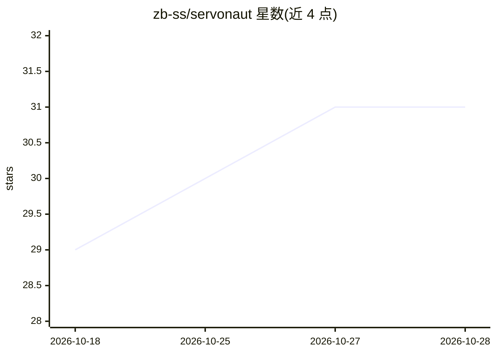

# zb-ss/servonaut

⭐ 31 · Python · MIT · 推送 2026-10-27 · [GitHub](https://github.com/zb-ss/servonaut) · 个人维护

**多云服务器管理 TUI，内置 AI 助手与 MCP 服务器**

基于 Textual 的终端界面，统一列出并管理 AWS EC2、OVHcloud、Hetzner Cloud 及自定义 SSH 服务器：支持 SSH/SCP、远程命令、日志浏览、CloudWatch/CloudTrail 浏览器、IP 封禁、服务器记忆缓存。AI 部分包括内置聊天助手（OpenAI/Anthropic/Gemini/Ollama 或托管 Servonaut AI）、AI 日志分析、本地语音转录合成，以及约 80 个工具的 MCP 服务器供 Claude Code/Cursor 等调用。部分功能（托管 AI、监控发现、记忆同步）标记为付费 Solo/Teams 计划。需 Python 3.10+ 与已配置的 AWS CLI。

## 筛选速览

| 维度 | 判定 | 备注 |
|---|---|---|
| AI 角色 | `ai-enhanced` | 去掉 AI 部分产品仍成立 |
| 许可风险 | `permissive` | MIT |
| 部署形态 | `desktop` | 安装包/桌面程序 |
| 模型依赖 | local-ok | 支持本地模型 |
| 硬件要求 | — | 无带数字的原话,不猜 |
| 安装摩擦 | `low` | 无编译、无系统依赖或容器化 |
| 成熟度 | `idea` | |

## 能力要点

- AWS/OVH/Hetzner/自定义服务器统一管理与搜索
- 内置 AI 助手支持 OpenAI/Anthropic/Gemini/Ollama 及托管 Servonaut AI
- MCP 服务器提供约 80 个工具，三档权限与 JSONL 审计
- 语音输入/朗读在本机运行，音频不离开工作站

## 适用场景

- 在一个界面里管理多家云商和自建服务器
- 让 AI 助手读取日志、执行命令并排查故障
- 把服务器操作工具暴露给 Claude Code、Cursor 等 agent 使用

## 场景标签

`AI 助手` · 领域:对话与助手

## 证据(README 行号)

> L5: Manage AWS, Hetzner, OVH, and custom servers from one terminal — with a built-in AI assistant and MCP server.
> L119: - **Interactive TUI** — mouse + keyboard, powered by Textual.
> L120: - **Multi-provider fleet** — AWS EC2, OVHcloud (dedicated / VPS / Public Cloud), Hetzner Cloud, and custom servers

## 星数曲线

2026-10-18 29 → 2026-10-28 31（+2）

---
*卡片 v1 · prompt 1.4 · 生成 2026-10-26 · 置信度 high · 依据 README sha `d2f8fef911aa` · [字段定义](../../DATASET.md)*
