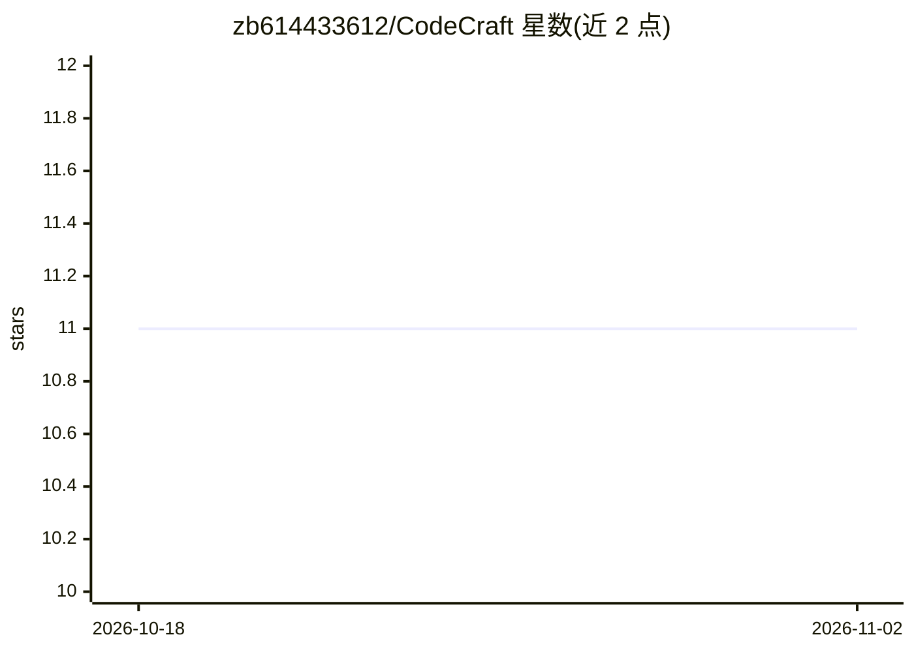

# zb614433612/CodeCraft

⭐ 11 · Java · MIT · 推送 2026-10-21 · [GitHub](https://github.com/zb614433612/CodeCraft) · 个人维护 · 中文 README

**多 LLM 驱动的桌面/终端 AI 编程 Agent，自然语言完成开发任务**

基于 Java 17 + Spring Boot + Vue 3 + Electron 的 AI 编程助手，以桌面应用与终端形态运行。通过统一 LLMClient 抽象层接入 10 类 Provider 模板（DeepSeek、GPT、OpenAI/Anthropic 公共契约、通义千问、火山方舟、Ollama、MiMo、MiniMax、自定义），运行时动态切换。面向开发者用户，提供 10 大类 29 个工具（文件读写、命令执行、Git、数据库、桌面自动化、浏览器自动化），支持多 Agent 任务拆解与并行执行、Agent 互相委托调用、MCP 双向接入、三层人机确认安全策略与代码快照回滚。安装包内置 JRE 与 H2 数据库，覆盖 Windows/macOS/Linux；开发者自建需 JDK 17+、Maven、Node.js。

## 筛选速览

| 维度 | 判定 | 备注 |
|---|---|---|
| AI 角色 | `ai-native` | 本体是模型或模型工具 |
| 许可风险 | `permissive` | MIT |
| 部署形态 | `desktop` | 安装包/桌面程序 |
| 模型依赖 | local-ok | 支持本地模型 |
| 硬件要求 | — | 无带数字的原话,不猜 |
| 安装摩擦 | `medium` | 含编译或系统依赖之一 |
| 成熟度 | — | 结构信号不足 |

## 能力要点

- 10 类 LLM Provider 模板，运行时动态切换，每 Agent 可绑定特定模型
- 多 Agent 并行协作：任务自动拆解，最多 20 并发，Agent 间委托调用
- 10 大类 29 个工具：文件/命令/Git/数据库/桌面自动化/浏览器自动化
- MCP 双向支持：作为 Client 接外部 Server，也作为 Server 供 Claude Desktop/Cursor 连接
- 安装包内置 JRE + Node.js + H2，三平台零配置运行

## 适用场景

- 用自然语言让 AI 直接读写文件、执行命令、管理 Git 完成开发任务
- 配置多个不同角色的 Agent 并行处理复杂任务
- 本地通过 Ollama 运行模型驱动编程助手

## 场景标签

 · 领域:开发者工具/AI 编程

## 证据(README 行号)

> L33: **CodeCraft** 是一个支持**多种大语言模型（DeepSeek / GPT / OpenAI 兼容 / Anthropic / 通义千问 / 火山方舟 / Ollama / MiMo / MiniMax 等）** 的 
> L35: 与普通的 AI ChatBot 聊天助手不同，CodeCraft 是一个真正具备**完整工具调用能力（Tool Use / Function Calling）** 的 **Autonomous Coding Agent（自主编程智

## 星数曲线

2026-10-18 11 → 2026-11-02 11（+0）

---
*卡片 v1 · prompt 1.4 · 生成 2026-11-02 · 置信度 high · 依据 README sha `8335629a670d` · [字段定义](../../DATASET.md)*
