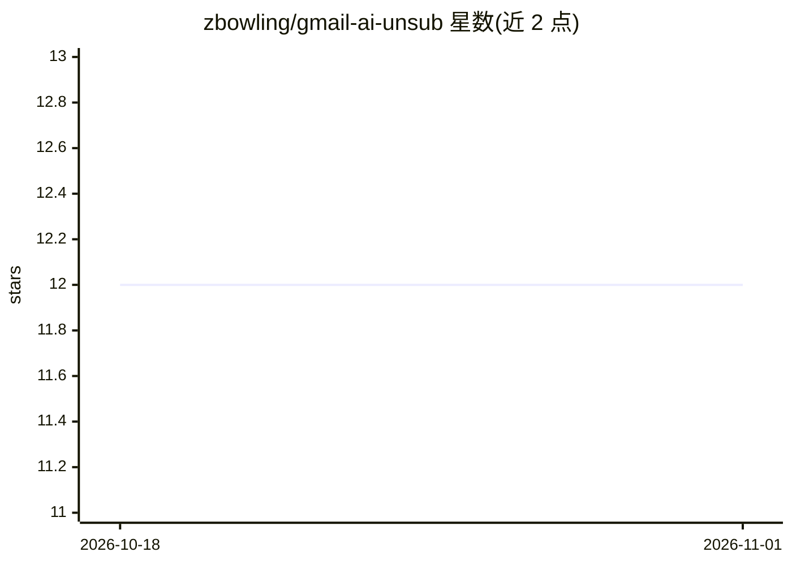

# zbowling/gmail-ai-unsub

⭐ 12 · Python · MIT · 推送 2025-12-03 · [GitHub](https://github.com/zbowling/gmail-ai-unsub) · [官网](https://zacbowling.com) · 个人维护

**用 LLM 识别并自动退订 Gmail 营销邮件的 CLI 工具**

Python 3.12+ 的命令行工具：通过 Gmail API（用户自建 OAuth 应用）拉取邮件，发送内容给 LLM（Gemini/Claude/OpenAI，可自定义分类提示词）判定营销邮件并打标签；退订阶段依次尝试 RFC 8058 一键退订（HTTP POST）、mailto 发信、以及结合 AI 视觉模型的浏览器自动化处理复杂退订页面。带交互式 setup 向导、状态跟踪（scan/unsubscribe/status 命令）。README 列出多个高失败率域名及手动变通方案。API 密钥与凭据仅本地存储，处理在本机进行，邮件内容会发送给所选 LLM 提供商。

## 筛选速览

| 维度 | 判定 | 备注 |
|---|---|---|
| AI 角色 | `ai-native` | 本体是模型或模型工具 |
| 许可风险 | `permissive` | MIT |
| 部署形态 | `library` | 以包/库形式分发 |
| 模型依赖 | locked-api |  |
| 硬件要求 | — | 无带数字的原话,不猜 |
| 安装摩擦 | `low` | 无编译、无系统依赖或容器化 |
| 成熟度 | — | 结构信号不足 |

## 能力要点

- LLM 分类营销邮件，提示词与判定标准可自定义
- 三级退订机制：RFC 8058 一键退订 → mailto → AI 视觉浏览器自动化
- 要求用户自建 Google Cloud OAuth 应用（工具 OAuth 应用未通过 Google 验证）
- 状态跟踪与已知高失败率域名清单

## 适用场景

- 批量清理 Gmail 收件箱中的营销邮件
- 对 AI 打标后的邮件自动执行退订操作
- 手动给邮件打标签后退订单个发件人

## 场景标签

`浏览器自动化` · 领域:效率与自动化

## 证据(README 行号)

> L3: AI-powered tool to identify and automatically unsubscribe from marketing emails in Gmail using Large Language Models
> L275:  - Sends email content to an LLM for classification

## 星数曲线

2026-10-18 12 → 2026-11-01 12（+0）

---
*卡片 v1 · prompt 1.4 · 生成 2026-10-31 · 置信度 high · 依据 README sha `f1c6be494ddd` · [字段定义](../../DATASET.md)*
