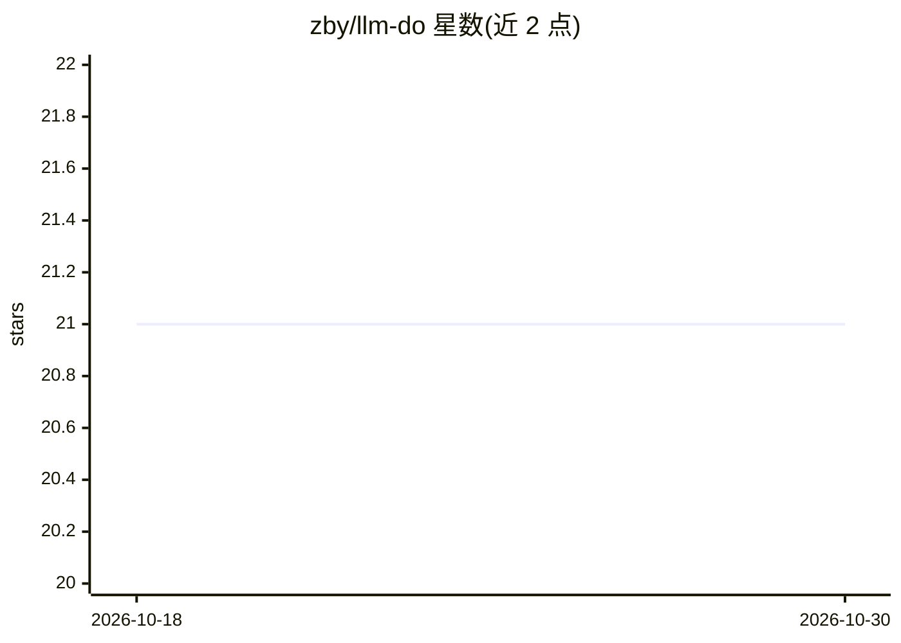

# zby/llm-do

⭐ 21 · Python · NOASSERTION · 推送 2026-03-02 · [GitHub](https://github.com/zby/llm-do) · 个人维护

**混合 VM 框架：LLM 推理与 Python 代码统一调用并可互相重构**

构建在 PydanticAI 之上的 agent 编排框架，把 LLM agent（.agent 文件）与 Python 工具纳入同一调用约定：agent 可调用工具或委托其他 agent。核心机制是“crystallisation”——把验证有效的提示模式逐步抽取为确定性 Python 函数，边界可双向移动。提供命令式 harness 层（原生 Python 控制流）、工具审批（gated syscalls）、CLI 与 Python 入口。模型通过 provider:model 格式配置（PydanticAI 约定）。自述实验性、API 可能变化，无内置 checkpointing/replay，隔离需容器或 VM。

## 筛选速览

| 维度 | 判定 | 备注 |
|---|---|---|
| AI 角色 | `ai-ecosystem` | LLM/agent 周边工具 |
| 许可风险 | `none` | NOASSERTION |
| 部署形态 | `library` | 以包/库形式分发 |
| 模型依赖 | locked-api |  |
| 硬件要求 | — | 无带数字的原话,不猜 |
| 安装摩擦 | `low` | 无编译、无系统依赖或容器化 |
| 成熟度 | `idea` | |

## 能力要点

- agent 与 Python 工具统一调用约定，边界可双向移动
- 渐进式稳定化（crystallisation）：提示模式抽取为可测试代码
- 命令式 harness：原生 if/for/try 控制流编排
- 工具级审批拦截危险操作

## 适用场景

- 用提示探索方案，稳定后抽取为 Python 代码迭代验证
- 以 Python 代码为入口编排多 agent 工作流
- 为文件操作、shell 命令等危险操作设置审批门

## 场景标签

`Agent 框架` `多智能体` · 领域:Agent 开发

## 证据(README 行号)

> L5: LLM reasoning and Python code share a unified execution model. Call an agent (LLM) or a tool (Python) with the same 
> L15: This is the **Unix philosophy for agents**: agents are defined in `.agent` files, dangerous operations are gated sy
> L227: **Experimental** — Built on PydanticAI. APIs may change.

## 星数曲线

2026-10-18 21 → 2026-10-30 21（+0）

---
*卡片 v1 · prompt 1.4 · 生成 2026-10-28 · 置信度 high · 依据 README sha `764fd1c863a7` · [字段定义](../../DATASET.md)*
