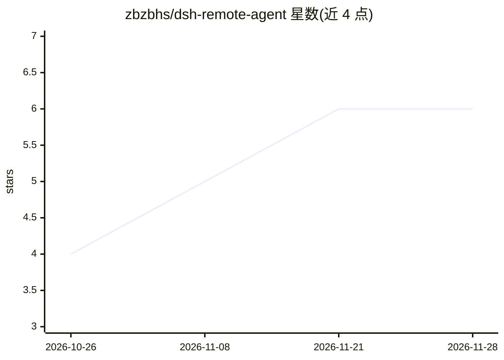

# zbzbhs/dsh-remote-agent

⭐ 6 · JavaScript · MIT · 推送 2026-11-02 · [GitHub](https://github.com/zbzbhs/dsh-remote-agent) · 个人维护 · 中文 README

**DSH 插件：把副机变成远程 Agent 任务执行节点**

一个 DSH（DeepSeek Harness）插件，在主机与副机之间建立任务委派通道：任务在副机本地持久运行，主机只接收 handoff 结果卡与产物清单，成品需显式拉取。支持 exec/agent 两种任务模式、负载感知路由、两阶段审批、断点续传、端到端加密中继、环境体检与一键修复，提供 Web 管理面板。零外部 npm 依赖，仅用 node 内置模块；要求 Node ^22.19.0 || >=24.0.0；Windows 全量验证，Linux/macOS 由 CI 覆盖。

## 筛选速览

| 维度 | 判定 | 备注 |
|---|---|---|
| AI 角色 | `ai-ecosystem` | LLM/agent 周边工具 |
| 许可风险 | `permissive` | MIT |
| 部署形态 | `desktop` | 安装包/桌面程序 |
| 模型依赖 | — | README 未给出锁定关系 |
| 硬件要求 | — | 无带数字的原话,不猜 |
| 安装摩擦 | `low` | 无编译、无系统依赖或容器化 |
| 成熟度 | — | 结构信号不足 |

## 能力要点

- 任务委派在副机本地持久运行，断连不终止，重连自动对账
- 产物按 final/intermediate/other 三分类，仅 final 可拉取，支持断点续传
- 24 个 remote_* 工具：任务派发、只读文件访问、双向传输、进程诊断、桌面截图
- 环境体检、错误翻译与两步确认的一键修复机制

## 适用场景

- 用家里另一台电脑分担 DSH 的长时任务
- 在 Windows 副机上跑构建、git 操作等命令而不占用主机
- 跨网（NAT 后）通过中继让两台机器协作跑 agent 任务

## 场景标签

`多智能体` · 领域:Agent 开发

## 证据(README 行号)

> L10: 把另一台电脑变成你 DSH 的**远程 Agent 同事**。
> L99: |**两种任务模式**|`exec` 直接跑命令（`D:\work` 里 `npm run build`、`git pull`、批量重命名）；`agent` 让副机起**独立 Agent 会话**，它自己规划、调工具、写文件|
> L287: ## 安装

## 星数曲线

2026-10-26 4 → 2026-11-28 6（+2）

---
*卡片 v1 · prompt 1.4 · 生成 2026-11-20 · 置信度 high · 依据 README sha `b1583b6146d6` · [字段定义](../../DATASET.md)*
