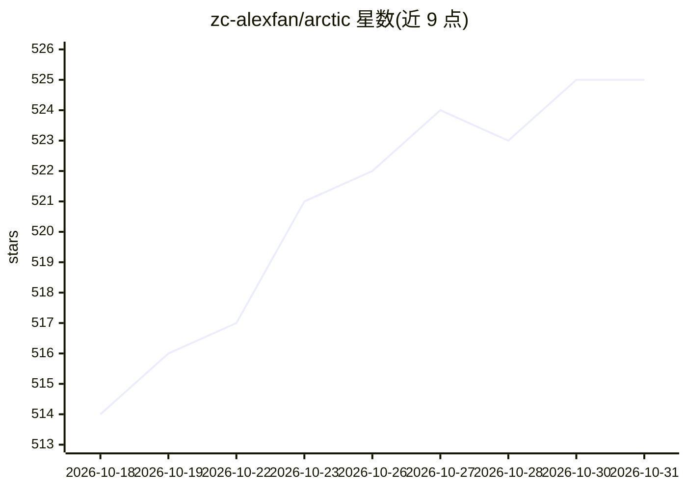

# zc-alexfan/arctic

⭐ 525 · Python · NOASSERTION · 推送 2026-03-04 · [GitHub](https://github.com/zc-alexfan/arctic) · [官网](https://arctic.is.tue.mpg.de) · 组织维护

**双手灵巧操作数据集 ARCTIC 的下载处理与基线训练代码库**

CVPR 2023 ARCTIC 数据集的官方仓库：提供数据集下载说明、预处理与切分脚本、RGB/深度/分割掩码渲染脚本、交互查看器，以及复现论文基线（ArcticNet、InterField）的训练评测代码。数据集含 2.1M 高分辨率图像（8 个第三人称视角 + 1 个第一人称视角）、SMPL-X/MANO/铰接物体三维标注，由 54 台 Vicon 相机采集，支持双手物体重建、运动生成、基准评测等任务。面向计算机视觉研究者，需注册账号下载数据。

## 筛选速览

| 维度 | 判定 | 备注 |
|---|---|---|
| AI 角色 | `ai-knowledge` | 知识聚合/清单类 |
| 许可风险 | `none` | NOASSERTION |
| 部署形态 | `None` |  |
| 模型依赖 | — | README 未给出锁定关系 |
| 硬件要求 | — | 无带数字的原话,不猜 |
| 安装摩擦 | `low` | 无编译、无系统依赖或容器化 |
| 成熟度 | — | 结构信号不足 |

## 能力要点

- 2.1M 图像 + SMPL-X/MANO/铰接物体三维标注
- 数据处理、切分与 RGB/深度/掩码渲染脚本
- 交互式数据查看器与预测结果查看器
- ArcticNet / InterField 基线的通用训练评测代码

## 适用场景

- 双手-铰接物体交互重建研究的训练与评测
- 生成抓取或全身运动模型的数据来源
- 铰接物体姿态估计基准测试与排行榜评测

## 场景标签

 · 领域:计算机视觉/三维视觉

## 证据(README 行号)

> L14: This is a repository for preprocessing, splitting, visualizing, and rendering (RGB, depth, segmentation masks) the 
> L46: - It contains 2.1M high-resolution images paired with annotated frames, enabling large-scale machine learning.

## 星数曲线

2026-10-18 514 → 2026-10-31 525（+11）

---
*卡片 v1 · prompt 1.4 · 生成 2026-10-21 · 置信度 high · 依据 README sha `69369b7e1bb5` · [字段定义](../../DATASET.md)*
