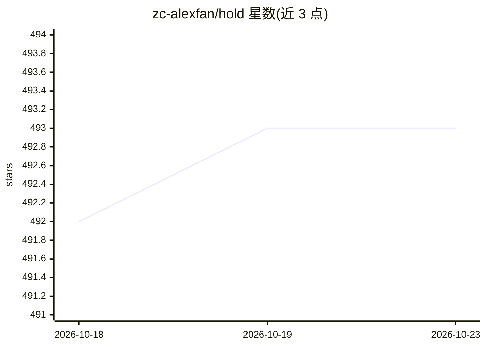

# zc-alexfan/hold

⭐ 493 · Python · MIT · 推送 2026-03-10 · [GitHub](https://github.com/zc-alexfan/hold) · [官网](https://zc-alexfan.github.io/hold) · 组织维护

**CVPR'24 方法：单目视频免模板联合重建手与物体 3D**

HOLD 是 CVPR 2024 Highlight 论文的官方仓库，提供从单目视频联合重建关节手与新物体 3D 几何的方法，不依赖预扫描物体模板与 3D 手-物体训练数据。基于体渲染框架重建动态手物交互，代码库支持单手与双手（ARCTIC 刚体物体）设置，附带预处理的 in-the-wild 序列下载、自定义视频预处理与训练脚本、交互式查看器，以及在 HO3D 上评测对比的代码。面向计算机视觉方向的研究者与开发者。

## 筛选速览

| 维度 | 判定 | 备注 |
|---|---|---|
| AI 角色 | `ai-native` | 本体是模型或模型工具 |
| 许可风险 | `permissive` | MIT |
| 部署形态 | `None` |  |
| 模型依赖 | — | README 未给出锁定关系 |
| 硬件要求 | — | 无带数字的原话,不猜 |
| 安装摩擦 | `low` | 无编译、无系统依赖或容器化 |
| 成熟度 | — | 结构信号不足 |

## 能力要点

- 免模板的单目视频手-物体联合 3D 重建（CVPR'24 Highlight）
- 体渲染框架重建动态手物交互
- 支持单手与双手+刚体物体（ARCTIC）设置
- 提供自定义视频预处理、训练脚本与交互式查看器

## 适用场景

- 对我自己拍摄的单目视频做手与物体的 3D 重建
- 在 ARCTIC/HO3D 数据集上训练评测双手物体重建
- 研究免模板双手/多物体交互重建方向

## 场景标签

 · 领域:计算机视觉/3D 重建

## 证据(README 行号)

> L33: This is a repository for HOLD, a method that jointly reconstructs hands and objects from monocular videos without a
> L35: HOLD can reconstruct 3D geometries of novel objects and hands:

## 星数曲线

2026-10-18 492 → 2026-10-23 493（+1）

---
*卡片 v1 · prompt 1.4 · 生成 2026-10-21 · 置信度 high · 依据 README sha `bd16a8570674` · [字段定义](../../DATASET.md)*
