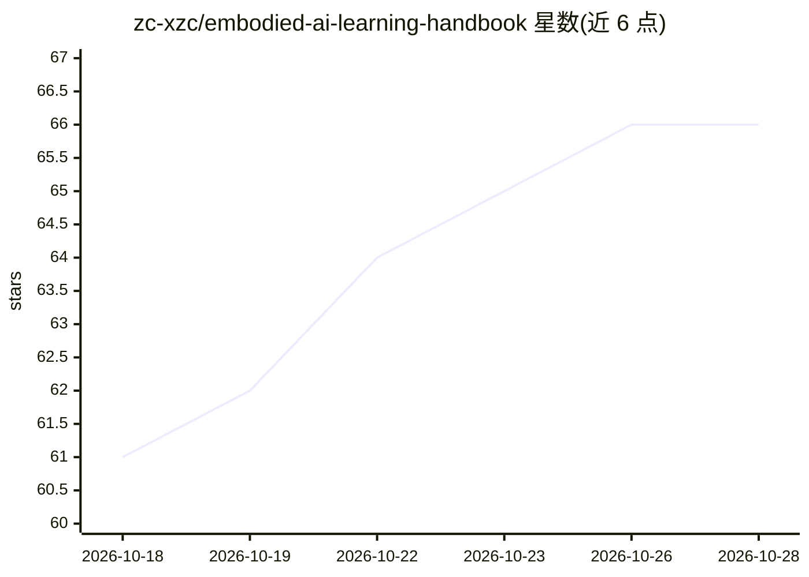

# zc-xzc/embodied-ai-learning-handbook

⭐ 66 · NOASSERTION · 推送 2026-08-15 · [GitHub](https://github.com/zc-xzc/embodied-ai-learning-handbook) · 个人维护 · 中文 README

**具身智能系统性学习手册：17 目录 69 篇文档与 1800+ 资源**

面向具身智能学习者的 Markdown 知识手册，共 17 个目录、69 篇文档，整合 1800+ 篇论文、技术文档与项目资源分析。内容覆盖基础理论（机器人学、Transformer、Diffusion）、模仿/强化学习算法、VLA 模型与 Sim2Real 前沿技术、仿真环境实战（MuJoCo、Isaac Lab 等）、遥操作与数据飞轮、顶会论文精选及行业报告。提供面向初学者、CV/NLP 转向、工业界速成、研究方向探索的四条学习路径。采用 CC BY-NC-SA 4.0 非商业许可，接受 PR 贡献。

## 筛选速览

| 维度 | 判定 | 备注 |
|---|---|---|
| AI 角色 | `ai-knowledge` | 知识聚合/清单类 |
| 许可风险 | `none` | NOASSERTION |
| 部署形态 | `None` |  |
| 模型依赖 | — | README 未给出锁定关系 |
| 硬件要求 | — | 无带数字的原话,不猜 |
| 安装摩擦 | `low` | 无编译、无系统依赖或容器化 |
| 成熟度 | — | 结构信号不足 |

## 能力要点

- 17 个目录、69 篇 Markdown 文档，整合 1800+ 篇论文与项目资源
- 覆盖 VLA 模型、Diffusion Policy、Sim2Real、世界模型等前沿技术
- 提供 4 条针对不同背景的推荐学习路径
- 收录顶会论文精选（CVPR/AAAI/ICLR/NeurIPS 2023-2025）与行业产业报告

## 适用场景

- 系统学习具身智能从基础到前沿的完整知识体系
- 从 CV/NLP 或工业界背景切入 VLA 模型与遥操作实践
- 查找具身智能方向的论文、开源项目与实验室资源
- 了解人形机器人、灵巧手等领域的行业趋势与岗位信息

## 场景标签

`教程课程` `精选清单` · 领域:学习与行业

## 证据(README 行号)

> L3: > 一份系统性的具身智能（Embodied AI）学习指南，覆盖从基础理论到前沿技术、从仿真实验到真机部署的完整知识体系。整合了 1800+ 篇论文、技术文档和项目资源的深度分析。
> L11: 本手册是一份面向具身智能学习者的系统性知识指南，旨在帮助读者快速建立从感知-决策-执行的闭环认知框架，并提供可落地的实践路径。手册共包含 **17 个目录、69 篇 Markdown 文档**，内容涵盖：

## 星数曲线

2026-10-18 61 → 2026-10-28 66（+5）

---
*卡片 v1 · prompt 1.4 · 生成 2026-10-24 · 置信度 high · 依据 README sha `8b0fbc378996` · [字段定义](../../DATASET.md)*
