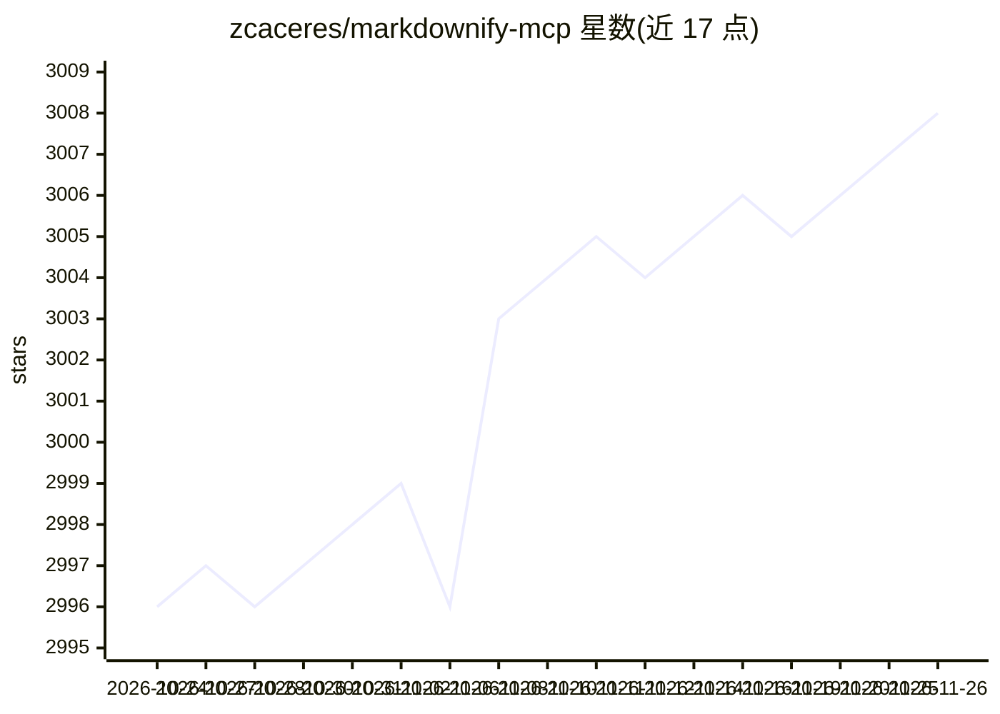

# zcaceres/markdownify-mcp

⭐ 3,008 · TypeScript · MIT · 推送 2026-11-25 · [GitHub](https://github.com/zcaceres/markdownify-mcp) · 个人维护

**MCP 服务器：把 PDF/音频/网页等转换为 Markdown**

实现 Model Context Protocol 的服务器，提供一组工具将文件与网页内容转为 Markdown：支持 PDF、图片（OCR）、音频（转录）、DOCX/XLSX/PPTX，以及 YouTube 字幕、Bing 搜索结果、通用网页，并可读取已有 Markdown 文件。默认以 stdio 运行，可切换为无状态 Streamable HTTP（默认仅监听回环地址，无内置鉴权，需配合 MD_ALLOWED_PATHS 做读取边界限制）。安装依赖 Bun、Node.js 22+ 与 uv 管理的 Python 环境，另提供 Docker 镜像（仅含 pdf 功能子集）。

## 筛选速览

| 维度 | 判定 | 备注 |
|---|---|---|
| AI 角色 | `ai-ecosystem` | LLM/agent 周边工具 |
| 许可风险 | `permissive` | MIT |
| 部署形态 | `self-host` | docker 或自建部署 |
| 模型依赖 | — | README 未给出锁定关系 |
| 硬件要求 | — | 无带数字的原话,不猜 |
| 安装摩擦 | `low` | 无编译、无系统依赖或容器化 |
| 成熟度 | — | 结构信号不足 |

## 能力要点

- 10 个转换工具：PDF/图片/音频/DOCX/XLSX/PPTX/网页/YouTube/Bing 搜索
- 支持 stdio 与 Streamable HTTP 两种传输模式
- MD_ALLOWED_PATHS 限制服务器可读取的目录边界
- 提供 Docker 镜像并进入 Docker MCP catalog（mcp/markdownify）

## 适用场景

- 给支持 MCP 的桌面应用添加文件转 Markdown 工具
- 把网页、YouTube 视频或 Bing 搜索结果转成 Markdown 存档
- 通过 HTTP 方式在本地把文档目录批量转为 Markdown

## 场景标签

`文档解析` `OCR` · 领域:知识与检索

## 证据(README 行号)

> L5: Markdownify is a Model Context Protocol (MCP) server that converts various file types and web content to Markdown fo
> L89: ## Usage with HTTP (Streamable HTTP transport)

## 星数曲线

2026-10-24 2,996 → 2026-11-26 3,008（+12）

---
*卡片 v1 · prompt 1.4 · 生成 2026-11-26 · 置信度 high · 依据 README sha `ea44402d3aab` · [字段定义](../../DATASET.md)*
