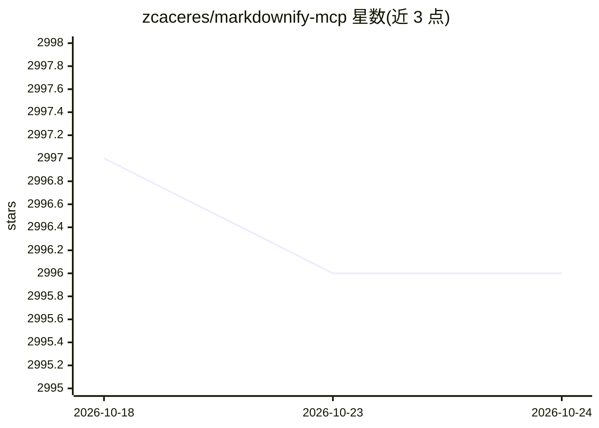

# zcaceres/markdownify-mcp

⭐ 2,996 · TypeScript · MIT · 推送 2026-09-25 · [GitHub](https://github.com/zcaceres/markdownify-mcp) · 个人维护

**把 PDF/图片/音频/网页等转成 Markdown 的 MCP 服务器**

面向 MCP 客户端的转换服务：暴露 10 个工具，将 PDF、DOCX、XLSX、PPTX、图片、音频（含转录）、YouTube 视频、Bing 搜索结果与一般网页转换为 Markdown 文本，也可读取已有 Markdown 文件。核心依赖 Python 端 markitdown（preinstall 自动建 venv），TypeScript 层用 Bun 构建运行；支持 MD_ALLOWED_PATHS 限制可读目录。注意 Docker 精简镜像仅装 markitdown[pdf]，音频转录与图片 OCR 需本地完整安装。

## 筛选速览

| 维度 | 判定 | 备注 |
|---|---|---|
| AI 角色 | `ai-ecosystem` | LLM/agent 周边工具 |
| 许可风险 | `permissive` | MIT |
| 部署形态 | `self-host` | docker 或自建部署 |
| 模型依赖 | — | README 未给出锁定关系 |
| 硬件要求 | — | 无带数字的原话,不猜 |
| 安装摩擦 | `low` | 无编译、无系统依赖或容器化 |
| 成熟度 | — | 结构信号不足 |

## 能力要点

- 10 个 MCP 工具覆盖 PDF/Office/图片/音频/网页到 Markdown 的转换
- 音频转 Markdown 含转录，图片转 Markdown 含元数据
- MD_ALLOWED_PATHS 环境变量限制文件读取边界
- 提供 Docker 运行方式与 Docker MCP 目录镜像

## 适用场景

- 让 Claude 等 MCP 客户端读取本地 PDF/Office 文档内容
- 把 YouTube 视频或网页转为 Markdown 供模型引用
- 将音频转录为 Markdown 文本

## 场景标签

`文档解析` · 领域:知识与检索

## 证据(README 行号)

> L5: Markdownify is a Model Context Protocol (MCP) server that converts various file types and web content to Markdown fo
> L51: To integrate this server with a desktop app, add the following to your app's server configuration:

## 星数曲线

2026-10-18 2,997 → 2026-10-24 2,996（-1）

---
*卡片 v1 · prompt 1.4 · 生成 2026-10-20 · 置信度 high · 依据 README sha `3c06c08af0fa` · [字段定义](../../DATASET.md)*
