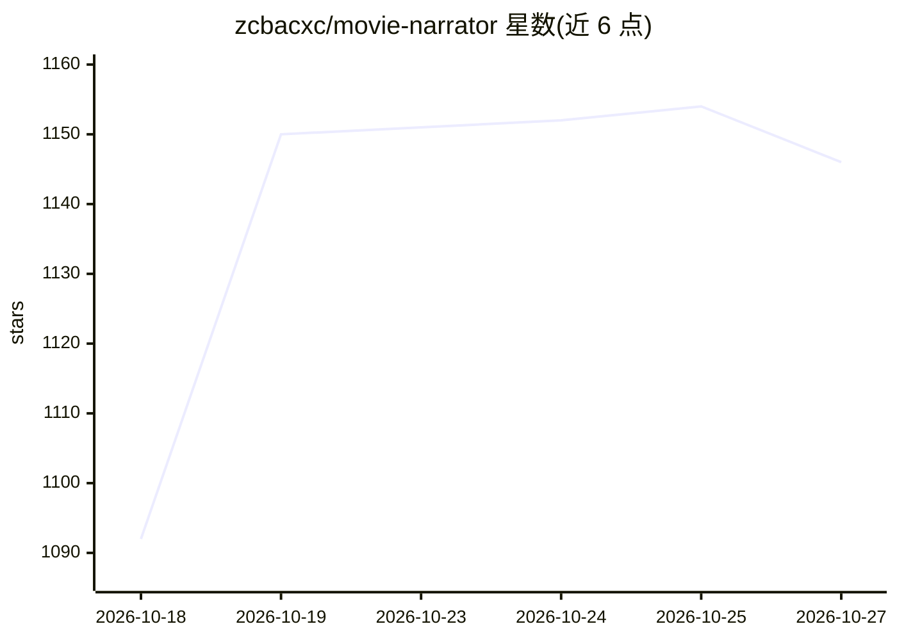

# zcbacxc/movie-narrator

⭐ 1,146 · Python · AGPL-3.0 · 推送 2026-09-16 · [GitHub](https://github.com/zcbacxc/movie-narrator) · 个人维护 · 中文 README

**一条命令生成带解说的电影解说视频（脚本+配音+字幕+成片）**

Python 开源工具包，从单条命令或 YAML 配置出发，经 16 步流水线自动生成电影解说视频：LLM 生成解说脚本（默认本地 Ollama，兼容任意 OpenAI 接口服务）、Edge-TTS 配音、SRT 字幕与多语言翻译、场景检测与片段匹配、BGM 混音、1080p/4K 渲染，并含黑帧/幻灯片风险等 QA 门禁。支持多候选赛马、VLM 场景描述、TMDB 资料核查，可扩展 TTS/LLM 后端。限制：Edge-TTS 为逆向接口仅限非商业测试；中文 ASR 等可选功能依赖较多。面向内容创作者与自动化开发者。

## 筛选速览

| 维度 | 判定 | 备注 |
|---|---|---|
| AI 角色 | `ai-native` | 本体是模型或模型工具 |
| 许可风险 | `viral` | AGPL-3.0 |
| 部署形态 | `library` | 以包/库形式分发 |
| 模型依赖 | local-ok | 支持本地模型 |
| 硬件要求 | — | 无带数字的原话,不猜 |
| 安装摩擦 | `low` | 无编译、无系统依赖或容器化 |
| 成熟度 | — | 结构信号不足 |

## 能力要点

- 16 步流水线：脚本生成→配音→字幕→渲染→QA 一条龙
- 默认本地 Ollama 运行 LLM，兼容任意 OpenAI 接口服务
- 多候选赛马与参考视频风格模仿
- 可扩展插件架构（自定义 TTS/LLM 后端）与远程推理

## 适用场景

- 自动批量产出短视频平台风格的电影解说视频
- 本地 LLM 离线生成解说脚本与配音
- 多语言/双语字幕版本一键生成

## 场景标签

`视频生成` `语音合成` `AI 写作` · 领域:内容生成

## 证据(README 行号)

> L18: - 🎬 LLM-powered movie recap script generation
> L19: - 🔊 Text-to-Speech narration (Edge-TTS by default)
> L29: - 🎞️ Video rendering (1080p/4K output)

## 星数曲线

2026-10-18 1,092 → 2026-10-27 1,146（+54）

---
*卡片 v1 · prompt 1.4 · 生成 2026-10-21 · 置信度 high · 依据 README sha `3f169f8d9935` · [字段定义](../../DATASET.md)*
