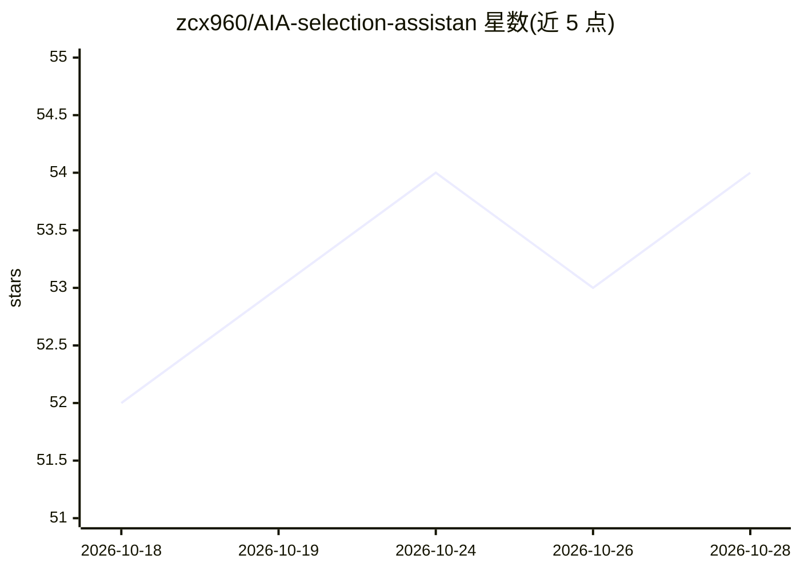

# zcx960/AIA-selection-assistan

⭐ 54 · TypeScript · MIT · 推送 2026-10-20 · [GitHub](https://github.com/zcx960/AIA-selection-assistan) · 个人维护 · 中文 README

**macOS/Windows 全局划词 AI 助手：翻译润色解释、截图识图**

常驻菜单栏/系统托盘的 Electron 桌面应用：在任意应用中选中文字后浮出工具栏，可触发翻译、解释、总结、润色、搜索、复制、朗读等动作，动作可自定义提示词、绑定 API 模板与快捷键。内置区域截图（可标注、钉图）并交给 AI 识图，结果窗为独立多轮对话，支持流式输出与思维链实时显示。模型接入 OpenAI-compatible 与 Anthropic 两类 API，API Key 仅存本地。限制：替换回填仅 Windows x64 润色动作，Linux 非正式支持。

## 筛选速览

| 维度 | 判定 | 备注 |
|---|---|---|
| AI 角色 | `ai-native` | 本体是模型或模型工具 |
| 许可风险 | `permissive` | MIT |
| 部署形态 | `desktop` | 安装包/桌面程序 |
| 模型依赖 | — | README 未给出锁定关系 |
| 硬件要求 | — | 无带数字的原话,不猜 |
| 安装摩擦 | `low` | 无编译、无系统依赖或容器化 |
| 成熟度 | — | 结构信号不足 |

## 能力要点

- 选中文本浮出工具栏，内置翻译/解释/总结/润色/搜索/复制/朗读动作
- 区域截图可标注、钉图并交给 AI 识图，图片上下文在追问中保留
- 润色结果可一键写回原应用选区（Windows x64，仅润色动作）
- 多套 API 模板（OpenAI-compatible / Anthropic），按动作指定模型与思考强度

## 适用场景

- 阅读外文资料时随手划词翻译或解释，少切换窗口
- 润色改写文字并把结果直接替换回原应用
- 截一块屏幕交给 AI 识图并继续追问

## 场景标签

`AI 助手` · 领域:对话与助手

## 证据(README 行号)

> L20: AIA划词助手是一个常驻菜单栏 / 系统托盘的小工具。在任意应用里选中一段文字，旁边会浮出一条工具栏，点一下就能翻译、解释、总结、润色、搜索、复制或朗读；不想用工具栏，也可以走全局快捷键。工具栏动作可以新增、重命名、换图标、改提示
> L26: 模型这边可接 **OpenAI-compatible**（自建 endpoint、OpenAI、DeepSeek、月之暗面、智谱、各类第三方代理都行）或 **Anthropic** 官方 API。多套模板可一键切换 endpoin
> L64: - 独立 AI 对话窗口，支持多轮上下文与流式追问

## 星数曲线

2026-10-18 52 → 2026-10-28 54（+2）

---
*卡片 v1 · prompt 1.4 · 生成 2026-10-24 · 置信度 high · 依据 README sha `4c16bd247646` · [字段定义](../../DATASET.md)*
