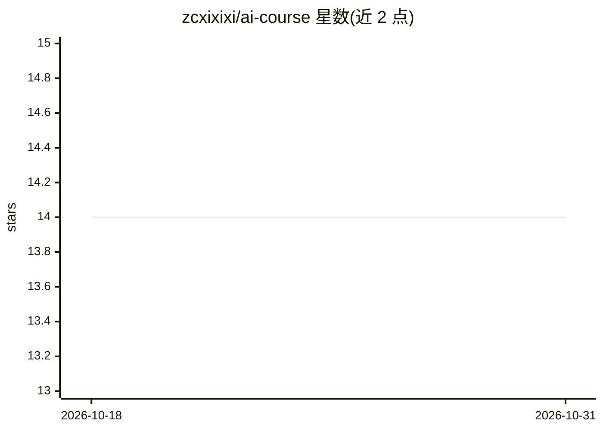

# zcxixixi/ai-course

⭐ 14 · Jupyter Notebook · 推送 2026-06-18 · [GitHub](https://github.com/zcxixixi/ai-course) · 组织维护 · 中文 README

**面向非科班研究生的 AI 课程资料：课件、demo 与作业**

维护 8 次研究生人工智能课程的资料仓库，涵盖机器学习、神经网络、计算机视觉、NLP、大模型与 AIGC 等主题。提供课堂 demo（自动贪吃蛇、YOLO 摄像头识别、ML 回归、MNIST/CNN 互动、MoveNet 姿态估计、Qwen2.5-0.5B + llama.cpp 本地问答），配套每节课的作业要求、GitHub Issues/Discussion 提交流程与成绩说明。作业含隐私提醒（不提交姓名学号等敏感信息），综合项目要求结合科研方向完成 AI 项目或视频生成项目。

## 筛选速览

| 维度 | 判定 | 备注 |
|---|---|---|
| AI 角色 | `ai-knowledge` | 知识聚合/清单类 |
| 许可风险 | `none` | — |
| 部署形态 | `library` | 以包/库形式分发 |
| 模型依赖 | — | README 未给出锁定关系 |
| 硬件要求 | — | 无带数字的原话,不猜 |
| 安装摩擦 | `low` | 无编译、无系统依赖或容器化 |
| 成熟度 | — | 结构信号不足 |

## 能力要点

- 8 次课程主题覆盖 ML/CV/NLP/大模型
- 6 个可运行课堂 demo，含浏览器端与本地端侧推理
- 作业通过 GitHub Issues/Discussion 提交，附隐私提醒
- Demo 07 使用 Qwen2.5-0.5B-Instruct GGUF + llama.cpp 本机推理（首次下载约 469MB）

## 适用场景

- 我按课程顺序学习 AI 基础并跑通配套 demo
- 我在本地体验端侧小模型推理并与云端 API 对比
- 我需要了解作业提交与评分要求

## 场景标签

`教程课程` `科研工具` · 领域:学习与行业

## 证据(README 行号)

> L5: 本仓库用于维护 8 次人工智能课程资料。
> L37: 1. 人工智能概述
> L44: 8. 大模型与 AIGC

## 星数曲线

2026-10-18 14 → 2026-10-31 14（+0）

---
*卡片 v1 · prompt 1.4 · 生成 2026-10-31 · 置信度 mid · 依据 README sha `9febae62552b` · [字段定义](../../DATASET.md)*
