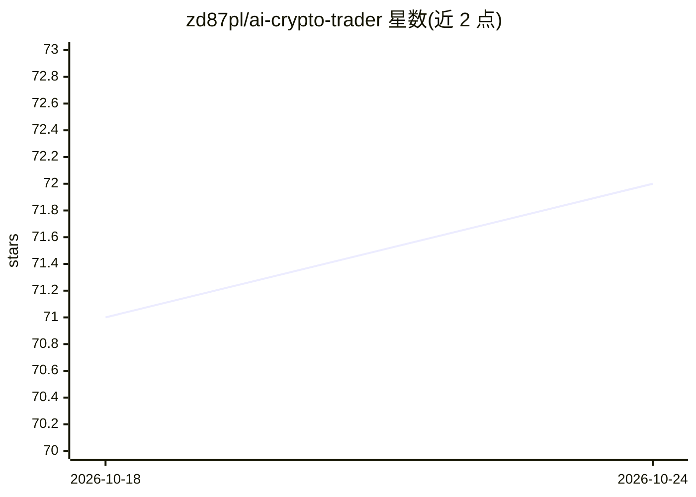

# zd87pl/ai-crypto-trader

⭐ 72 · Python · 推送 2026-03-08 · [GitHub](https://github.com/zd87pl/ai-crypto-trader) · 个人维护

**实验性加密货币自动交易系统：AI 信号生成与社交情绪分析**

面向教育与研究的加密货币交易系统，由十余个微服务组成：从 Binance 读取实时行情并计算技术指标，经 LunarCrush 获取社交情绪与新闻，用 OpenAI GPT-4 生成交易信号，再由执行服务自动下单；另含策略进化（遗传算法+GPT 优化）、市场状态检测（KMeans/GMM/HMM）、神经网络价格预测（LSTM/GRU 等）、VaR 与蒙特卡洛风险管理和回测框架，通过 Redis 传递消息，Docker Compose 一键启动并附带可视化仪表盘。README 明确声明仅供教育研究、不构成投资建议。

## 筛选速览

| 维度 | 判定 | 备注 |
|---|---|---|
| AI 角色 | `ai-native` | 本体是模型或模型工具 |
| 许可风险 | `none` | — |
| 部署形态 | `self-host` | docker 或自建部署 |
| 模型依赖 | — | README 未给出锁定关系 |
| 硬件要求 | — | 无带数字的原话,不猜 |
| 安装摩擦 | `low` | 无编译、无系统依赖或容器化 |
| 成熟度 | `idea` | |

## 能力要点

- OpenAI GPT-4 结合社交情绪生成交易信号并自动执行
- 16 个微服务架构：行情/情绪监控、策略进化、市场状态检测、风险管理
- 神经网络价格预测支持 LSTM/GRU/CNN-LSTM/Attention 及集成模型
- 内置回测框架与实时可视化仪表盘

## 适用场景

- 学习 AI 驱动的自动化交易系统的架构与实现
- 在历史数据上回测 AI 交易策略的表现
- 观察社交情绪与加密货币价格的相关性分析

## 场景标签

`金融量化` · 领域:学习与行业

## 证据(README 行号)

> L85: - Processes market updates using OpenAI GPT-4
> L92: - Executes trades based on AI analysis signals

## 星数曲线

2026-10-18 71 → 2026-10-24 72（+1）

---
*卡片 v1 · prompt 1.4 · 生成 2026-10-24 · 置信度 mid · 依据 README sha `f828d0a4c108` · [字段定义](../../DATASET.md)*
