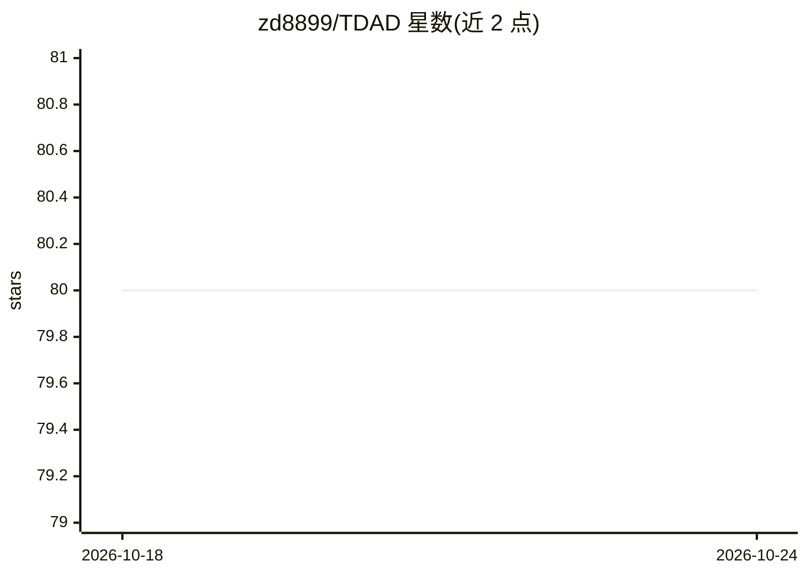

# zd8899/TDAD

⭐ 80 · TypeScript · MIT · 推送 2026-05-22 · [GitHub](https://github.com/zd8899/TDAD) · [官网](https://tdad.ai/) · 个人维护

**给 AI 编程用户的可视化测试驱动开发工作流引擎**

VS Code 扩展形式的 Prompt 工程平台：以 Canvas 可视化看板组织功能节点，强制 Plan→Spec→Test→Fix 流程。用户将生成的提示词粘贴到自己的 AI 代理（Claude、Cursor 等）产出 Gherkin 规格与测试，TDAD 用 Playwright 执行测试并自动捕获执行轨迹、网络请求、DOM 快照与截图，组装成 Golden Packet 供 AI 修复失败测试。不直接调用任何 AI API，代码不出本机；支持既有代码库反向映射与依赖动作复用。

## 筛选速览

| 维度 | 判定 | 备注 |
|---|---|---|
| AI 角色 | `ai-ecosystem` | LLM/agent 周边工具 |
| 许可风险 | `permissive` | MIT |
| 部署形态 | `library` | 以包/库形式分发 |
| 模型依赖 | — | README 未给出锁定关系 |
| 硬件要求 | — | 无带数字的原话,不猜 |
| 安装摩擦 | `low` | 无编译、无系统依赖或容器化 |
| 成熟度 | — | 结构信号不足 |

## 能力要点

- Canvas 可视化看板以 Grey/Red/Green 呈现功能节点状态
- BDD→测试→运行→修复 四步线性流水线
- 测试失败时组装含执行轨迹/网络请求/DOM 快照的 Golden Packet
- 不调用 AI API，配合用户已有的 AI 订阅使用

## 适用场景

- 让 AI 编程代理按测试驱动流程交付可运行的功能
- 可视化追踪 AI 开发项目中各功能的通过与失败状态
- 将既有代码库反向映射为功能节点纳入管理

## 场景标签

`提示工程` `浏览器自动化` · 领域:Agent 开发

## 证据(README 行号)

> L37: * **🔐 Privacy First:** TDAD does **not** call any AI APIs directly. No code leaves your machine unless you paste it
> L107: TDAD does not call OpenAI/Claude for code generation. Instead, it serves as a **Prompt Engineering Platform** with

## 星数曲线

2026-10-18 80 → 2026-10-24 80（+0）

---
*卡片 v1 · prompt 1.4 · 生成 2026-10-24 · 置信度 mid · 依据 README sha `785600c0dafe` · [字段定义](../../DATASET.md)*
