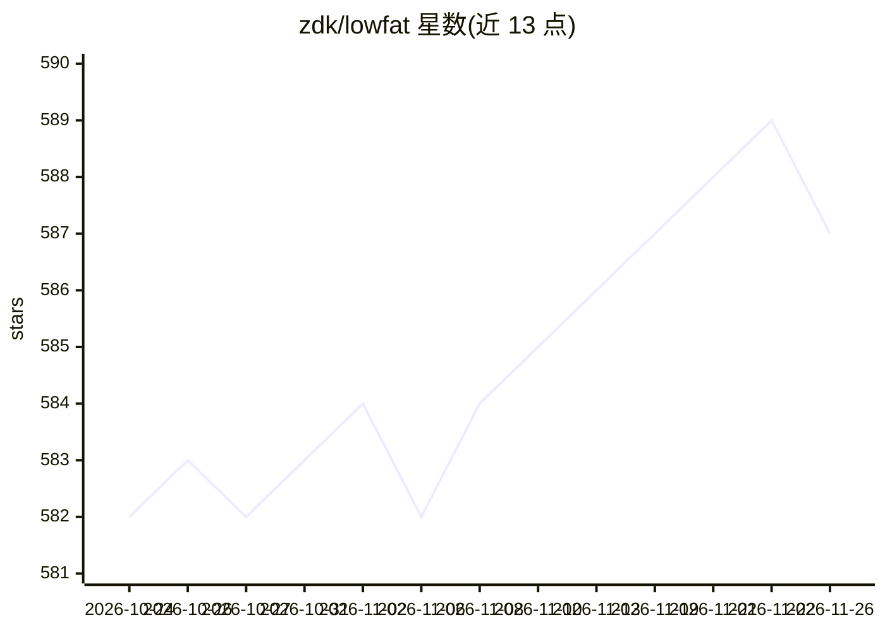

# zdk/lowfat

⭐ 587 · Rust · Apache-2.0 · 推送 2026-11-06 · [GitHub](https://github.com/zdk/lowfat) · 个人维护

**为 AI agent 过滤 CLI 输出与文件内容以降低 token 成本的 CLI 工具**

用 Rust 编写的单一二进制 CLI，在命令输出与文件内容进入 agent 上下文前进行过滤压缩，提供 lite/full/ultra 三档压缩级别，内置 git、docker、grep、find、ls、tree 六个命令的过滤器，并可通过 .lf DSL、shell 或 Python 编写自定义插件。接入方式包括 Claude Code hook、OpenCode 插件、shell 集成、Pi agent 前缀及直接命令前缀；post-read 功能可在读取源码、Markdown、HTML、JSON、锁文件时压缩内容。本地运行，无遥测，提供 stats/history 做节省分析。

## 筛选速览

| 维度 | 判定 | 备注 |
|---|---|---|
| AI 角色 | `ai-ecosystem` | LLM/agent 周边工具 |
| 许可风险 | `permissive` | Apache-2.0 |
| 部署形态 | `library` | 以包/库形式分发 |
| 模型依赖 | — | README 未给出锁定关系 |
| 硬件要求 | — | 无带数字的原话,不猜 |
| 安装摩擦 | `low` | 无编译、无系统依赖或容器化 |
| 成熟度 | — | 结构信号不足 |

## 能力要点

- 三档压缩级别（lite/full/ultra）过滤命令输出
- post-read 文件内容压缩：代码去注释、锁文件摘要化等
- 通过 Claude Code hook / OpenCode 插件 / shell 集成接入多种 agent
- 本地 stats/history 分析，无遥测

## 适用场景

- 让编码 agent 在读取 git/docker 输出时消耗更少 token
- 压缩 agent 读取的源码与锁文件内容
- 按自身使用场景统计并调优 token 节省

## 场景标签

 · 领域:开发者工具/AI agent 工具链

## 证据(README 行号)

> L3: lowfat is a lightweight CLI tool that reduces AI token costs by filtering CLI output and file content before it reac
> L70: **Claude Code hook** — add to `.claude/settings.json`:
> L90: **OpenCode plugin** — one command, no config editing:

## 星数曲线

2026-10-24 582 → 2026-11-26 587（+5）

---
*卡片 v1 · prompt 1.4 · 生成 2026-11-25 · 置信度 high · 依据 README sha `f5e6ddf2147b` · [字段定义](../../DATASET.md)*
