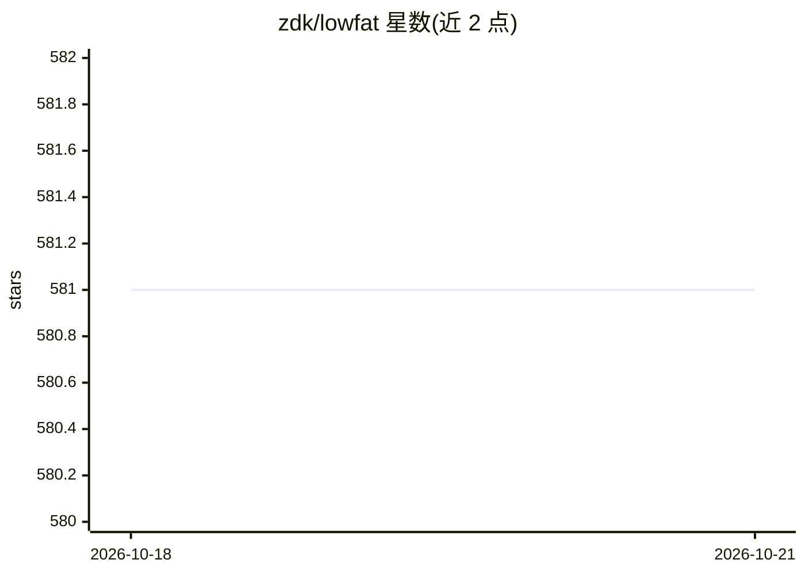

# zdk/lowfat

⭐ 582 · Rust · Apache-2.0 · 推送 2026-10-09 · [GitHub](https://github.com/zdk/lowfat) · 个人维护

**缩减 AI agent 上下文体积的 CLI 输出过滤器**

Rust 编写的轻量 CLI 工具，在命令输出与文件内容进入 agent 上下文前进行过滤压缩，以降低 token 消耗。内置 git/docker/grep/find/ls/tree 六类过滤器，提供 lite/full/ultra 三档压缩级别，支持 .lf DSL、shell 与 Python (PEP 723/uv) 编写自定义插件。集成途径包括 Claude Code hook、OpenCode 插件、shell 集成、Pi agent 与命令前缀直接调用；post-read 钩子可压缩源码、Markdown、HTML、JSON 与 lock 文件。本地优先，无遥测。

## 筛选速览

| 维度 | 判定 | 备注 |
|---|---|---|
| AI 角色 | `ai-ecosystem` | LLM/agent 周边工具 |
| 许可风险 | `permissive` | Apache-2.0 |
| 部署形态 | `library` | 以包/库形式分发 |
| 模型依赖 | — | README 未给出锁定关系 |
| 硬件要求 | — | 无带数字的原话,不猜 |
| 安装摩擦 | `low` | 无编译、无系统依赖或容器化 |
| 成熟度 | — | 结构信号不足 |

## 能力要点

- 内置 6 类命令过滤器，三档压缩级别（lite/full/ultra）
- post-read 压缩源码/Markdown/HTML/JSON/lock 文件（ultra 档折叠函数体为签名）
- 提供 Claude Code、OpenCode、shell、Pi agent 多种集成方式
- .lf DSL + shell + Python (PEP 723/uv) 插件扩展机制

## 适用场景

- 给编码 agent 的 git/docker 输出瘦身，降低 token 成本
- 通过 Claude Code hook 自动重写 Bash 命令输出
- 压缩 agent 读取的大文件与 lock 文件以节省上下文

## 场景标签

 · 领域:开发者工具/LLM 上下文优化

## 证据(README 行号)

> L3: lowfat is a lightweight CLI tool that reduces AI token costs by filtering CLI output and file content before it reac
> L70: **Claude Code hook** — add to `.claude/settings.json`:

## 星数曲线

2026-10-18 581 → 2026-10-21 581（+0）

---
*卡片 v1 · prompt 1.4 · 生成 2026-10-22 · 置信度 high · 依据 README sha `b24a26c0240a` · [字段定义](../../DATASET.md)*
