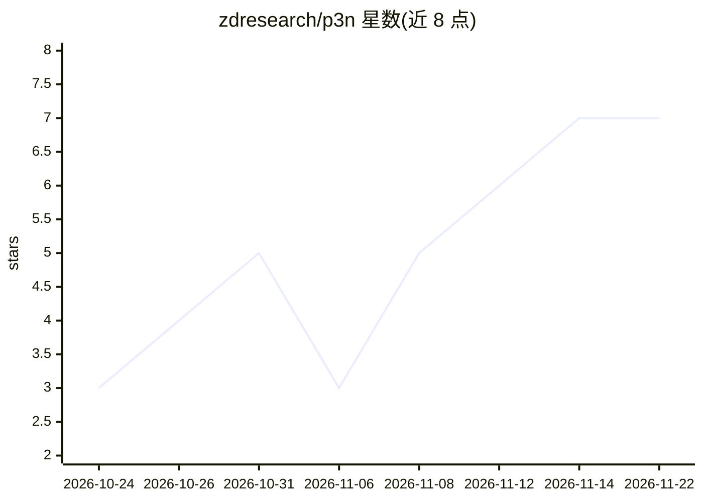

# zdresearch/p3n

⭐ 7 · Python · MIT · 推送 2026-11-09 · [GitHub](https://github.com/zdresearch/p3n) · [官网](https://p3n.si) · 个人维护

**给 AI agent 用的写作技能包：检测/删水/润稿/去 AI 味**

以 agent skill 形式组织的写作工具集，含四个技能：AI Detection（三段检查加裁决的 AI 文本检测）、Deslop（删冗余、追问缺失事实）、Editorial（带领域上下文的编辑）、Humanize（降低 AI 痕迹的重写）。机制上由主 agent 把读写工作交给子代理在小模型上执行，检测侧另用开源权重分类器 tropa-mini 作 oracle。技能通过软链接装入 Claude Code；同类功能也以托管 API 形式提供，按小时有限免费调用并有付费档。

## 筛选速览

| 维度 | 判定 | 备注 |
|---|---|---|
| AI 角色 | `ai-native` | 本体是模型或模型工具 |
| 许可风险 | `permissive` | MIT |
| 部署形态 | `library` | 以包/库形式分发 |
| 模型依赖 | locked-api |  |
| 硬件要求 | — | 无带数字的原话,不猜 |
| 安装摩擦 | `low` | 无编译、无系统依赖或容器化 |
| 成熟度 | — | 结构信号不足 |

## 能力要点

- 四个写作技能：AI Detection、Deslop、Editorial、Humanize
- 子代理架构：编辑者与写作者多轮迭代至分数达标或 5 轮
- 本地 oracle 为 DeBERTa-v3-large 四分类器（Apache-2.0），从 Hugging Face 下载
- 托管 API 提供同一套规则与提示词，可用版本号固定

## 适用场景

- 让 Claude Code 检查草稿是否有 AI 痕迹
- 发布前对技术/金融类文稿做删水与编辑打磨
- 高量场景下走托管 API 而非本地搭建 oracle

## 场景标签

`AI 写作` · 领域:内容生成

## 证据(README 行号)

> L3: The AI pen: writing skills for your AI agent.
> L13: Each folder in `skills/` is an agent skill: a `SKILL.md`, the rules and prompts, plus small scripts. For

## 星数曲线

2026-10-24 3 → 2026-11-22 7（+4）

---
*卡片 v1 · prompt 1.4 · 生成 2026-11-20 · 置信度 mid · 依据 README sha `24e9711d0771` · [字段定义](../../DATASET.md)*
