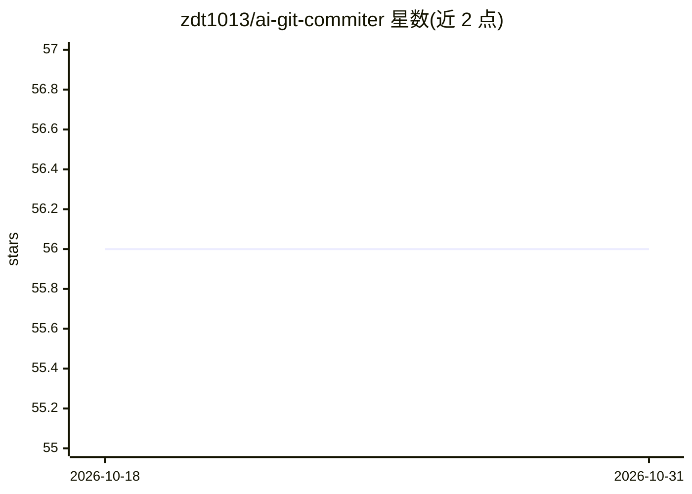

# zdt1013/ai-git-commiter

⭐ 56 · TypeScript · MIT · 推送 2026-09-07 · [GitHub](https://github.com/zdt1013/ai-git-commiter) · [官网](https://github.com/zdt1013/ai-git-commit) · 个人维护 · 中文 README

**AI 生成 Git Commit 消息的 VSCode 插件**

基于 AI 大模型的 VSCode/Cursor 扩展：读取 Git 变更（暂存区/工作区可选）后调用大模型生成规范化的中英文 Commit 消息并自动填入输入框。支持 OpenAI、Gemini、Anthropic 及 vLLM 自部署模型，提供提示词模板的添加/编辑/删除/远程下载管理，可注入最近 commit 历史作为风格参考，支持流式输出与 CLAUDE.md 等项目文档感知。使用前需配置对应提供商的 API 密钥；代码变更会被发送至所选 AI 提供商。

## 筛选速览

| 维度 | 判定 | 备注 |
|---|---|---|
| AI 角色 | `ai-native` | 本体是模型或模型工具 |
| 许可风险 | `permissive` | MIT |
| 部署形态 | `library` | 以包/库形式分发 |
| 模型依赖 | local-ok | 支持本地模型 |
| 硬件要求 | — | 无带数字的原话,不猜 |
| 安装摩擦 | `low` | 无编译、无系统依赖或容器化 |
| 成熟度 | — | 结构信号不足 |

## 能力要点

- 支持 OpenAI、Gemini、Anthropic 及 vLLM 自部署模型
- 提示词模板管理与远程模板下载
- 可注入最近 commit 历史作为风格参考
- 自动感知 CLAUDE.md 等项目文档作为上下文

## 适用场景

- 写代码后一键生成符合团队规范的 Commit 消息
- 按团队规范自定义提示词模板统一提交格式
- 接入自部署 vLLM 模型在内部环境生成消息

## 场景标签

 · 领域:开发者工具/Git

## 证据(README 行号)

> L3:  这是一个基于AI大模型的Git Commit自动生成的VSCode插件。它可以帮助您根据代码变更自动生成高质量的Commit消息，提高开发效率。
> L39: 1. **📝 自动生成Commit消息**：在VSCode源代码管理标签页中，点击新增的图标按钮，即可根据当前代码变更自动生成Commit消息。
> L41: 3. **🧠 多AI模型支持**：支持OpenAI和Google Gemini等多种AI大模型。

## 星数曲线

2026-10-18 56 → 2026-10-31 56（+0）

---
*卡片 v1 · prompt 1.4 · 生成 2026-10-24 · 置信度 mid · 依据 README sha `d50b1b3eed25` · [字段定义](../../DATASET.md)*
