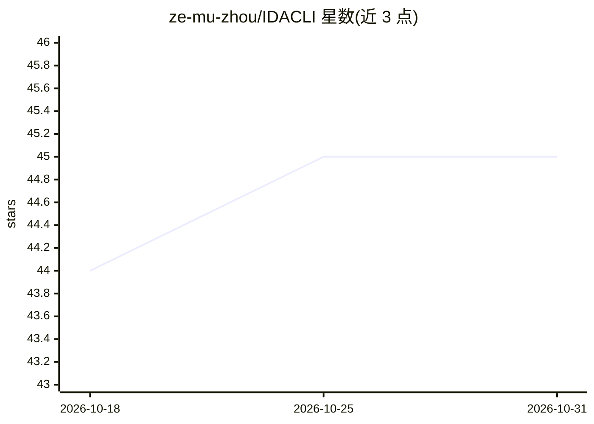

# ze-mu-zhou/IDACLI

⭐ 45 · Python · MIT · 推送 2026-07-31 · [GitHub](https://github.com/ze-mu-zhou/IDACLI) · 个人维护 · 中文 README

**让 AI Agent 通过 JSONL 直接操控 IDA Pro 的 Python 内核**

面向 AI Agent 的 IDA Pro / Hex-Rays 无界面内核：Agent 经 stdin/stdout JSONL 协议向活跃 IDA 数据库发送任意 IDAPython 代码，获得结构化 JSON 响应；提供 40+ 个返回 JSON 的高层辅助函数、内置索引缓存与跨会话缓存复用、artifact 落盘、并行分析与数据库变更（propose/apply 分离、冲突合并）。附 AgentSession 一行接入与 Daemon 常驻模式（loopback 绑定 + token 认证）。要求 Python 3.11+ 与 IDA Pro 9.0+（idalib），运行时依赖为零；内置 Kimi Code / Codex / Claude Code / Reasonix 的 skill 分发脚本。

## 筛选速览

| 维度 | 判定 | 备注 |
|---|---|---|
| AI 角色 | `ai-ecosystem` | LLM/agent 周边工具 |
| 许可风险 | `permissive` | MIT |
| 部署形态 | `library` | 以包/库形式分发 |
| 模型依赖 | — | README 未给出锁定关系 |
| 硬件要求 | — | 无带数字的原话,不猜 |
| 安装摩擦 | `low` | 无编译、无系统依赖或容器化 |
| 成熟度 | — | 结构信号不足 |

## 能力要点

- stdin/stdout JSONL 协议执行无限制 IDAPython
- 40+ 返回 JSON 的 ai.* 高层辅助函数
- 持久缓存、artifact 落盘与并行进程级隔离分析
- Daemon 常驻内核（loopback + 随机 token 认证）

## 适用场景

- 让 Claude Code / Codex 等 Agent 在逆向任务中直接驱动 IDA
- CTF/pwn 分析中持久化复用 IDA 数据库会话与缓存
- 多分支工作流下对重命名、注释、打补丁做确定性合并

## 场景标签

`网络安全` · 领域:学习与行业

## 证据(README 行号)

> L20: 现有的 IDA 集成方案通过 MCP 或 REST 暴露一组固定的工具，AI 只能在别人定义好的抽象边界内工作。IDA-CLI 采用完全不同的思路：直接把一个**原始 Python 内核**交给 Agent，通过 stdin/st
> L68: ### 多 Agent Skill 分发

## 星数曲线

2026-10-18 44 → 2026-10-31 45（+1）

---
*卡片 v1 · prompt 1.4 · 生成 2026-10-25 · 置信度 high · 依据 README sha `37bed2ffffdb` · [字段定义](../../DATASET.md)*
