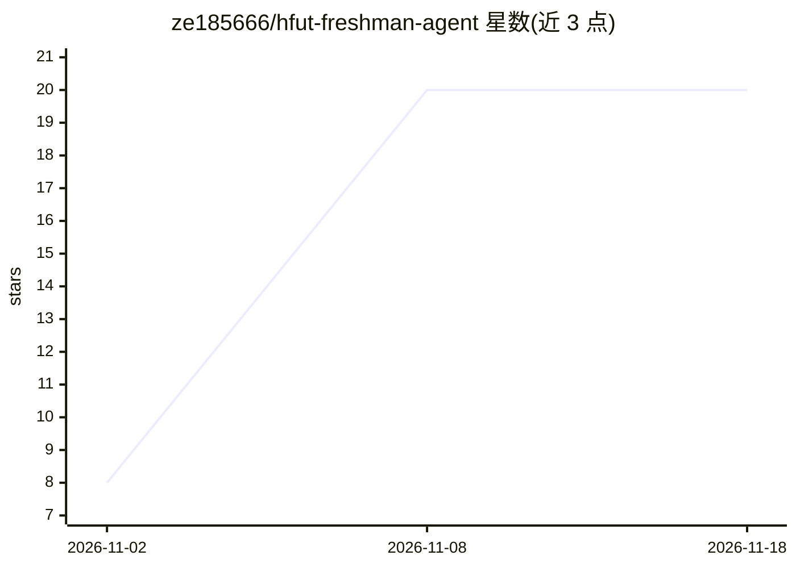

# ze185666/hfut-freshman-agent

⭐ 20 · HTML · 推送 2026-10-31 · [GitHub](https://github.com/ze185666/hfut-freshman-agent) · 个人维护 · 中文 README

**面向合工大新生的免登录 Coze Web SDK 聊天页**

合肥工业大学工科新生 AI 助教页面：将已在扣子（Coze）平台搭建好的 Agent 通过 Web SDK 以 iframe 形式嵌入单文件 HTML，用户打开网页即可直接对话，无需注册账号。面向高数 A、电路分析等课程学习问题。包含启动兜底逻辑（脚本拦截、token 失效、网络异常提示与重试）与 MutationObserver 监听 iframe 加载。运行方式为静态托管，令牌需在前端代码中手动替换。README 明确提示令牌写在前端等于公开，只适合演示和课程作业。

## 筛选速览

| 维度 | 判定 | 备注 |
|---|---|---|
| AI 角色 | `ai-native` | 本体是模型或模型工具 |
| 许可风险 | `none` | — |
| 部署形态 | `None` |  |
| 模型依赖 | — | README 未给出锁定关系 |
| 硬件要求 | — | 无带数字的原话,不猜 |
| 安装摩擦 | `low` | 无编译、无系统依赖或容器化 |
| 成熟度 | — | 结构信号不足 |

## 能力要点

- 单文件 HTML，无构建无依赖，任意静态托管即可运行
- 免登录直聊，SDK iframe 铺满视口适配移动端
- 三种启动异常（脚本拦截/token 失效/网络异常）的提示与重试
- MutationObserver 监听 iframe 加载，20 秒超时判定失败

## 适用场景

- 大一工科新生直接打开网页提问高数、电路等课程问题
- 分享到班级群供同学免注册使用
- 作为课程作业或演示用的嵌入式 Agent 聊天页模板

## 场景标签

`聊天机器人` `AI 助手` · 领域:对话与助手

## 证据(README 行号)

> L3: 合肥工业大学工科新生 AI 助教 —— 基于扣子（Coze）Web SDK 的免登录嵌入式聊天页。
> L5: 面向大一工科新生的高频痛点：高数 A 听不懂、电路分析不会做题、找不到学长笔记和真题课件。这个页面把已经搭好的 Agent 直接嵌进网页，打开就能问，不用注册、不用跳转。

## 星数曲线

2026-11-02 8 → 2026-11-18 20（+12）

---
*卡片 v1 · prompt 1.4 · 生成 2026-11-18 · 置信度 high · 依据 README sha `6d2a33156124` · [字段定义](../../DATASET.md)*
