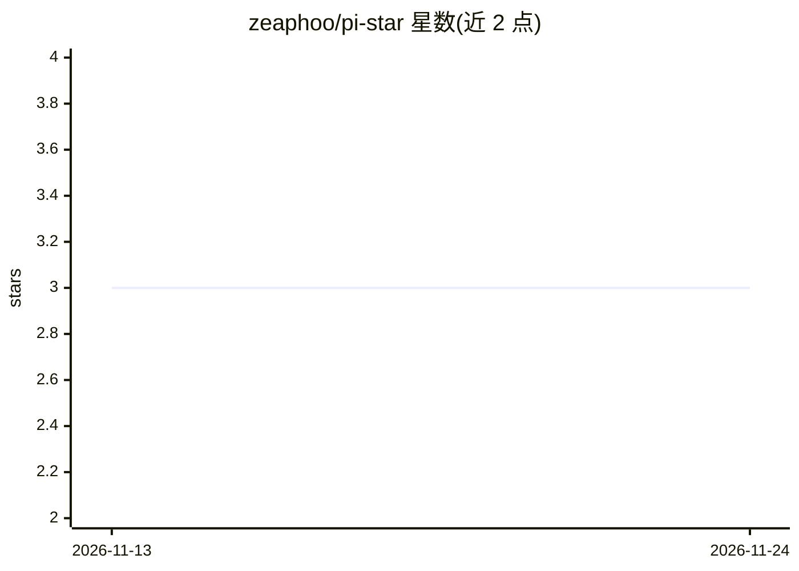

# zeaphoo/pi-star

⭐ 3 · TypeScript · Apache-2.0 · 推送 2026-11-23 · [GitHub](https://github.com/zeaphoo/pi-star) · [官网](quadhub.cloud/product/pi-star/) · 个人维护 · 中文 README

**pi coding agent 的跨平台桌面工作台，集编码循环于一窗**

围绕 pi coding agent 构建的跨平台桌面应用，把 agent 会话、代码浏览、Git diff 审查、PTY 终端与会话时间线放进同一窗口，共享 `~/.pi/agent` 下的会话数据，可与 pi CLI、pi-web 协同。提供 Node.js 原生 PI 与 Rust 实现 QuickPI 双引擎，可切换。安装包自带 Node、pi CLI 与（Windows 上）MinGit，支持 deb/AppImage/NSIS/msi/portable/dmg，macOS 构建已签名公证；Linux 需 WebKitGTK 4.1，Windows 需 WebView2。

## 筛选速览

| 维度 | 判定 | 备注 |
|---|---|---|
| AI 角色 | `ai-ecosystem` | LLM/agent 周边工具 |
| 许可风险 | `permissive` | Apache-2.0 |
| 部署形态 | `desktop` | 安装包/桌面程序 |
| 模型依赖 | — | README 未给出锁定关系 |
| 硬件要求 | — | 无带数字的原话,不猜 |
| 安装摩擦 | `low` | 无编译、无系统依赖或容器化 |
| 成熟度 | — | 结构信号不足 |

## 能力要点

- 同一窗口内完成指挥 agent、读代码、审 diff、跑终端
- 双引擎：原生 PI（Node.js 子进程）与 QuickPI（Rust 进程内实现）
- 安装包捆绑 Node、pi CLI 与 MinGit，无需预装
- 会话数据与 pi CLI / pi-web 共享

## 适用场景

- 在桌面端统一管理 pi agent 的会话与分支
- 审查 agent 修改的代码 diff 并在同一窗口跑测试调试
- 无需 Node 环境时使用 QuickPI 引擎运行 agent

## 场景标签

`编码 Agent` · 领域:编码与开发

## 证据(README 行号)

> L5: **An all-in-one coding desktop app built around a code agent.** Direct the agent, read code, review
> L8: pi-star brings the pieces of a coding loop into one cross-platform desktop app: while the agent edits
> L10: session and tooling ecosystem of pi coding agent and keeps
> L37: |**Native PI (Node.js)**|`pi --mode rpc` subprocess, same codebase as the pi CLI|Default; full compatibility with T

## 星数曲线

2026-11-13 3 → 2026-11-24 3（+0）

---
*卡片 v1 · prompt 1.4 · 生成 2026-11-21 · 置信度 high · 依据 README sha `ec6037f82ede` · [字段定义](../../DATASET.md)*
