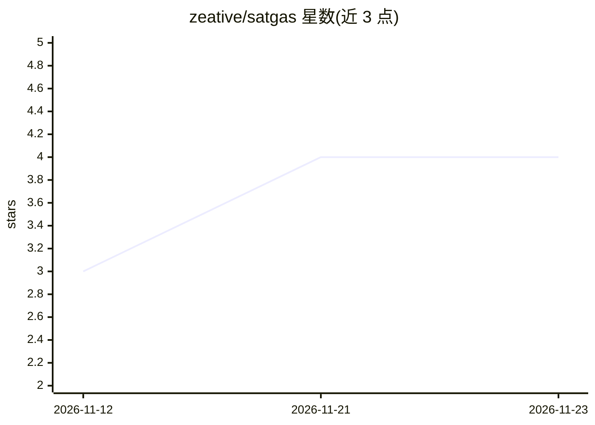

# zeative/satgas

⭐ 4 · TypeScript · AGPL-3.0 · 推送 2026-11-16 · [GitHub](https://github.com/zeative/satgas) · [官网](https://satgas.kejaa.id) · 组织维护 · 中文 README

**自托管画布，让 Claude Code/Codex 代理组队协作完成任务**

自托管的多代理工作区：用户提交一条请求后，lead 代理按需招募角色、拆分至多 12 个任务，各任务按依赖关系以默认 3 个并发运行，结果以卡片形式落在共享画布上（文档、表格、代码、页面实时预览）。代理本体是本机或服务器上的真实 Claude Code / Codex CLI，产出真实文件。支持 git worktree 隔离改动、diff 查看与回退、定时与 webhook 触发、Telegram/WhatsApp 通道，UI 提供英文与印尼语。

## 筛选速览

| 维度 | 判定 | 备注 |
|---|---|---|
| AI 角色 | `ai-ecosystem` | LLM/agent 周边工具 |
| 许可风险 | `viral` | AGPL-3.0 |
| 部署形态 | `self-host` | docker 或自建部署 |
| 模型依赖 | local-ok | 支持本地模型 |
| 硬件要求 | — | 无带数字的原话,不猜 |
| 安装摩擦 | `low` | 无编译、无系统依赖或容器化 |
| 成熟度 | `idea` | |

## 能力要点

- lead 招募角色、规划最多 12 个任务并按依赖并发执行
- 结果以可编辑卡片落在共享画布，支持页面实时预览与设计面板
- 每个任务独立 diff 与回退，写任务在 git worktree 中隔离
- 支持定时/webhook 触发及 Telegram/WhatsApp 消息通道

## 适用场景

- 一条请求让多个编码代理分工完成并可视化追踪进度
- 在画布上研究竞对、撰写发布简报或制作演示文稿
- 关联 PR 让代理按评审意见迭代修改

## 场景标签

`多智能体` `编码 Agent` `工作流自动化` · 领域:Agent 开发

## 证据(README 行号)

> L7: A self-hosted canvas where your Claude Code and Codex agents work as a team you can see.
> L34: - **Own the whole thing.** The agents are the real Claude Code or Codex CLI on your machine or server, so the resul
> L102: - **Model providers.** Pick one model in the composer, and the lead and every task run on it. Claude Code serves y

## 星数曲线

2026-11-12 3 → 2026-11-23 4（+1）

---
*卡片 v1 · prompt 1.4 · 生成 2026-11-21 · 置信度 high · 依据 README sha `9dbb5e3eb6aa` · [字段定义](../../DATASET.md)*
