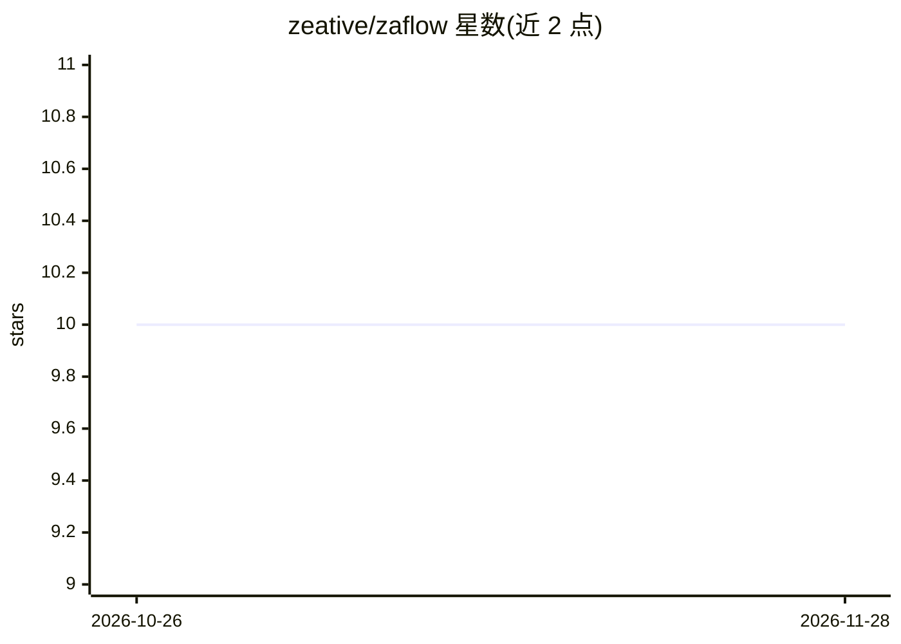

# zeative/zaflow

⭐ 10 · TypeScript · MIT · 推送 2025-12-24 · [GitHub](https://github.com/zeative/zaflow) · [官网](https://www.npmjs.com/package/zaflow) · 个人维护

**TypeScript 开发者构建 AI agent 工作流的轻量库**

面向 Node.js 与 TypeScript 开发者的 agent 编排库：提供 Provider（模型接入）、Tool（Zod 校验的函数调用）、Agent（独立提示词与工具）、Flow Control（步骤/条件/循环/并行）等抽象，支持 Single/Agentic/Autonomous 三种执行模式与 agent 间委派。自带 OpenAI、Groq、Ollama 三种内置 Provider 与自定义 Provider 接口，支持多模态消息与 Zod 约束的结构化输出。需 Node.js v20+，通过 npm/pnpm/bun 安装，MIT 许可。

## 筛选速览

| 维度 | 判定 | 备注 |
|---|---|---|
| AI 角色 | `ai-ecosystem` | LLM/agent 周边工具 |
| 许可风险 | `permissive` | MIT |
| 部署形态 | `library` | 以包/库形式分发 |
| 模型依赖 | local-ok | 支持本地模型 |
| 硬件要求 | — | 无带数字的原话,不猜 |
| 安装摩擦 | `low` | 无编译、无系统依赖或容器化 |
| 成熟度 | — | 结构信号不足 |

## 能力要点

- 三种执行模式：Single、Agentic（自动调用工具）、Autonomous（工具+agent 委派）
- 工具与结构化输出均基于 Zod schema 做类型安全校验
- 内置 OpenAI、Groq、Ollama Provider 与自定义 Provider 接口
- 大文件媒体引用系统：大型图片只传引用 ID 而非复制内容

## 适用场景

- 用 TypeScript 搭建带工具调用的聊天机器人或自治 agent
- 编排多个专业 agent 协作完成任务
- 强制模型按 JSON schema 输出类型安全的结构化数据

## 场景标签

`Agent 框架` `多智能体` · 领域:Agent 开发

## 证据(README 行号)

> L18:  ZaFlow is a blazing-fast, lightweight alternative to LangChain & LangGraph. Build powerful AI agents in minutes wi
> L36: > ZaFlow solves the complexity of building AI agent systems by providing a high-level, opinionated API. It is built
> L43: - ✅ **Multi-Provider** - OpenAI, Groq, Ollama, or custom provider

## 星数曲线

2026-10-26 10 → 2026-11-28 10（+0）

---
*卡片 v1 · prompt 1.4 · 生成 2026-11-19 · 置信度 high · 依据 README sha `1f45992cf6bb` · [字段定义](../../DATASET.md)*
