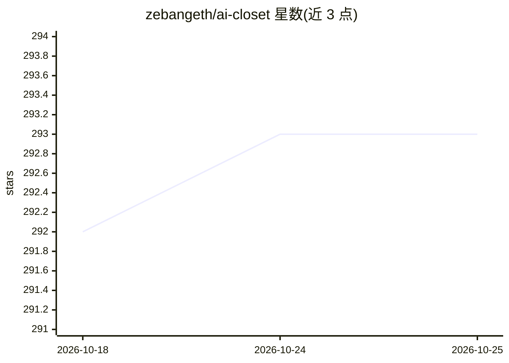

# zebangeth/ai-closet

⭐ 293 · TypeScript · MIT · 推送 2025-11-10 · [GitHub](https://github.com/zebangeth/ai-closet) · 个人维护

**AI 衣柜管理与虚拟试穿移动应用（iOS/Android）**

基于 React Native 与 Expo 的跨平台移动应用，面向个人用户的衣柜数字化与穿搭管理：从相册或相机添加衣物，AI 自动去除背景并分配类别、颜色、季节等属性；在自由画布上拖拽组合搭配并保存造型；上传个人照片后由 AI 生成虚拟试穿效果。AI 能力通过第三方 API 实现——OpenAI 做自动分类标注、fal.ai 做背景去除、Kwai Kolors 做虚拟试穿，需自行配置各 API key。当前仅实现客户端，云端代理与积分系统处于规划阶段。

## 筛选速览

| 维度 | 判定 | 备注 |
|---|---|---|
| AI 角色 | `ai-native` | 本体是模型或模型工具 |
| 许可风险 | `permissive` | MIT |
| 部署形态 | `library` | 以包/库形式分发 |
| 模型依赖 | — | README 未给出锁定关系 |
| 硬件要求 | — | 无带数字的原话,不猜 |
| 安装摩擦 | `low` | 无编译、无系统依赖或容器化 |
| 成熟度 | `idea` | |

## 能力要点

- AI 自动去除衣物图片背景并分配类别/颜色/季节属性
- 自由画布拖拽组合穿搭并保存造型
- 虚拟试穿：上传个人照片生成近似上身效果
- React Native + Expo 跨平台支持 iOS 与 Android

## 适用场景

- 把衣柜里的衣物拍照数字化存档并自动分类
- 在画布上混搭衣物设计并保存穿搭灵感
- 上传照片预览衣服（含网店商品）上身效果

## 场景标签

`图像生成` · 领域:内容生成

## 证据(README 行号)

> L9: **AI Closet** is a mobile application that brings an AI-powered approach to closet management and styling. Whether y
> L40:  Upload a personal photo and let the AI generate an approximate look.
> L66:  - The AI features require require the following APIs and keys, add them to your environment variables:

## 星数曲线

2026-10-18 292 → 2026-10-25 293（+1）

---
*卡片 v1 · prompt 1.4 · 生成 2026-10-22 · 置信度 high · 依据 README sha `f6b8bea23fd2` · [字段定义](../../DATASET.md)*
