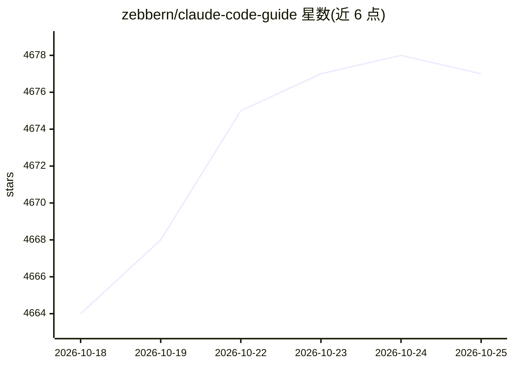

# zebbern/claude-code-guide

⭐ 4,676 · Python · MIT · 推送 2026-10-24 · [GitHub](https://github.com/zebbern/claude-code-guide) · 个人维护

**面向开发者的 Claude Code 使用指南（安装/命令/配置/MCP/技能）**

社区维护的 Claude Code 教程类知识库：以章节化文档覆盖入门安装、环境变量与配置文件、斜杠命令与 CLI 参考、权限与安全、自动化脚本（PR Review、Issue Triage）以及第三方集成（如 DeepSeek 接入示例）。安装部分罗列原生安装脚本、brew/winget/npm 等途径并给出系统要求；命令部分提供快照表格并声明以官方文档为权威。内容为 Markdown 参考文档，无本产品代码安装。

## 筛选速览

| 维度 | 判定 | 备注 |
|---|---|---|
| AI 角色 | `ai-knowledge` | 知识聚合/清单类 |
| 许可风险 | `permissive` | MIT |
| 部署形态 | `library` | 以包/库形式分发 |
| 模型依赖 | — | README 未给出锁定关系 |
| 硬件要求 | — | 无带数字的原话,不猜 |
| 安装摩擦 | `medium` | 含编译或系统依赖之一 |
| 成熟度 | — | 结构信号不足 |

## 能力要点

- 覆盖安装、配置、命令、安全、自动化与第三方集成的分章指南
- 提供 settings.json 与 CLAUDE.md 多层级配置文件说明
- 斜杠命令参考表（含实验性功能标注）
- 声明命令与模型映射变化快，以官方文档为权威来源

## 适用场景

- 初次上手 Claude Code 时按 Quick Start 完成安装与登录
- 查找斜杠命令和配置文件的作用
- 了解权限、安全与企业级策略文件的组织方式

## 场景标签

`教程课程` · 领域:学习与行业

## 证据(README 行号)

> L1: Claude Code Guide
> L3: _For reference and contributions, visit the official Claude Code documentation_
> L40: - **Getting Started**
> L72: - **Third-Party Integrations**

## 星数曲线

2026-10-18 4,664 → 2026-10-25 4,677（+13）

---
*卡片 v1 · prompt 1.4 · 生成 2026-10-20 · 置信度 mid · 依据 README sha `65fcc097dc47` · [字段定义](../../DATASET.md)*
