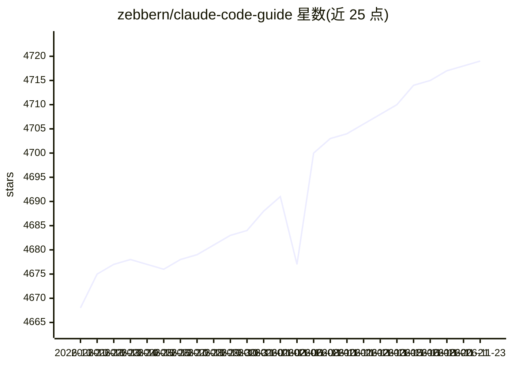

# zebbern/claude-code-guide

⭐ 4,719 · Python · MIT · 推送 2026-11-21 · [GitHub](https://github.com/zebbern/claude-code-guide) · 个人维护

**Claude Code 使用指南：从安装到高级工作流的命令与技巧手册**

围绕 Anthropic 的 Claude Code CLI 工具编写的第三方参考文档，按章节组织为安装（原生安装脚本、Homebrew/WinGet/npm 分发）、系统要求、环境变量与配置文件、斜杠命令、MCP、子代理与技能、安全权限、自动化脚本及第三方集成（DeepSeek、云平台网关）。内容注明命令与模型映射更新频繁，以官方文档为权威来源。面向从入门到进阶的 Claude Code 用户查阅。

## 筛选速览

| 维度 | 判定 | 备注 |
|---|---|---|
| AI 角色 | `ai-knowledge` | 知识聚合/清单类 |
| 许可风险 | `permissive` | MIT |
| 部署形态 | `self-host` | docker 或自建部署 |
| 模型依赖 | — | README 未给出锁定关系 |
| 硬件要求 | — | 无带数字的原话,不猜 |
| 安装摩擦 | `low` | 无编译、无系统依赖或容器化 |
| 成熟度 | — | 结构信号不足 |

## 能力要点

- 覆盖安装、配置、命令、MCP、子代理、技能、安全等章节的目录化参考
- 提供 macOS/Linux/Windows 三平台安装命令与包管理器分发说明
- 收录环境变量目录与 settings.json 多层级配置优先级说明
- 含第三方集成章节（DeepSeek、云服务与网关）

## 适用场景

- 首次安装与登录配置 Claude Code CLI
- 查找斜杠命令、快捷键与 CLI 参数的用法
- 配置环境变量、多作用域 settings.json 与权限策略
- 排查安装、认证与运行中的常见问题

## 场景标签

`教程课程` · 领域:学习与行业

## 证据(README 行号)

> L1: Claude Code Guide
> L3: _For reference and contributions, visit the official Claude Code documentation_
> L5: _Commands and provider model mappings change quickly; the linked official references remain authoritative._

## 星数曲线

2026-10-21 4,668 → 2026-11-23 4,719（+51）

---
*卡片 v1 · prompt 1.4 · 生成 2026-11-23 · 置信度 mid · 依据 README sha `6b0fcf37e9df` · [字段定义](../../DATASET.md)*
