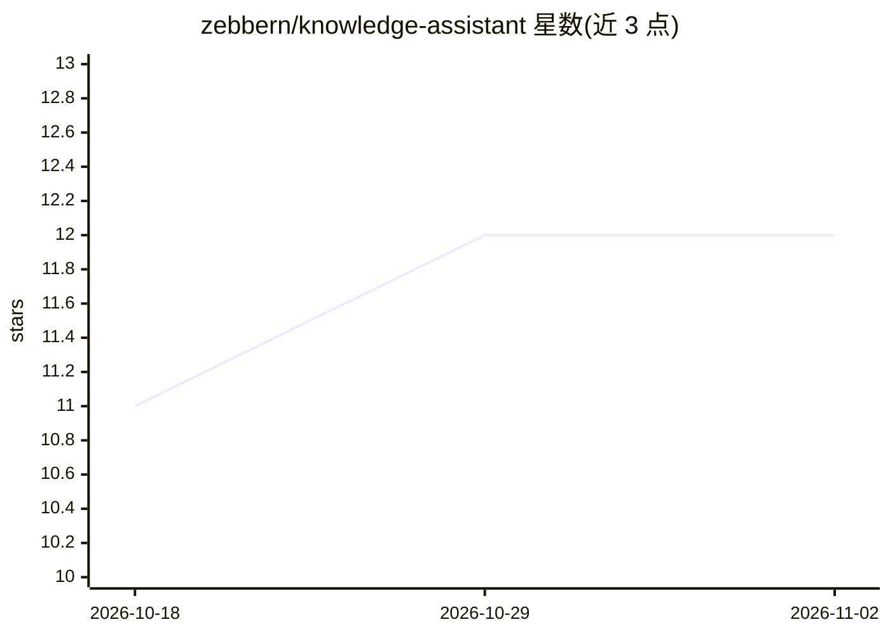

# zebbern/knowledge-assistant

⭐ 12 · TypeScript · 推送 2026-01-20 · [GitHub](https://github.com/zebbern/knowledge-assistant) · [官网](https://tryassistant.vercel.app/) · 个人维护

**基于本地 Markdown 文件问答的轻量聊天 agent，无需向量库**

Next.js 实现的文件知识库聊天应用：将 .md/.txt 文件放入 content/ 目录，请求时直接读取全文作为 LLM 上下文生成回答，不做预处理、分块或嵌入。模型通过 OpenRouter 免费层调用（Llama 3.3、Mimo、DeepSeek R1、Devstral、GLM 等），支持温度调节、自定义系统提示词、流式输出、Markdown/Mermaid 渲染、localStorage 会话持久化与导出。运行需 Node.js 18+ 与 OpenRouter API key，通过 npm 安装启动。上下文长度受文件总量与模型 token 上限约束。

## 筛选速览

| 维度 | 判定 | 备注 |
|---|---|---|
| AI 角色 | `ai-native` | 本体是模型或模型工具 |
| 许可风险 | `none` | — |
| 部署形态 | `library` | 以包/库形式分发 |
| 模型依赖 | locked-api |  |
| 硬件要求 | — | 无带数字的原话,不猜 |
| 安装摩擦 | `low` | 无编译、无系统依赖或容器化 |
| 成熟度 | — | 结构信号不足 |

## 能力要点

- 请求时读取 content/ 目录的 .md/.txt 文件直接作为 LLM 上下文
- 无向量数据库、无嵌入模型、无预处理步骤
- 经 OpenRouter 免费层调用 Llama 3.3 / Mimo / DeepSeek R1 / GLM 等模型
- 流式输出、Markdown/Mermaid 渲染、会话存储与导出

## 适用场景

- 给自己的文档或 GitHub 仓库搭一个问答界面
- 搭建个人知识库聊天助手
- 需要无向量库、零成本方案的知识问答场景

## 场景标签

`文档问答` `聊天机器人` `AI 助手` · 领域:对话与助手

## 证据(README 行号)

> L3: #### A lightweight, free, file-based chat agent that answers questions from your custom knowledge files. No vector d
> L25: - **No database** - Context goes directly to the LLM
> L42: Knowledge AI loads markdown files from a `content/` directory and uses them as context for AI responses. This appro

## 星数曲线

2026-10-18 11 → 2026-11-02 12（+1）

---
*卡片 v1 · prompt 1.4 · 生成 2026-10-31 · 置信度 high · 依据 README sha `7ec652df0126` · [字段定义](../../DATASET.md)*
