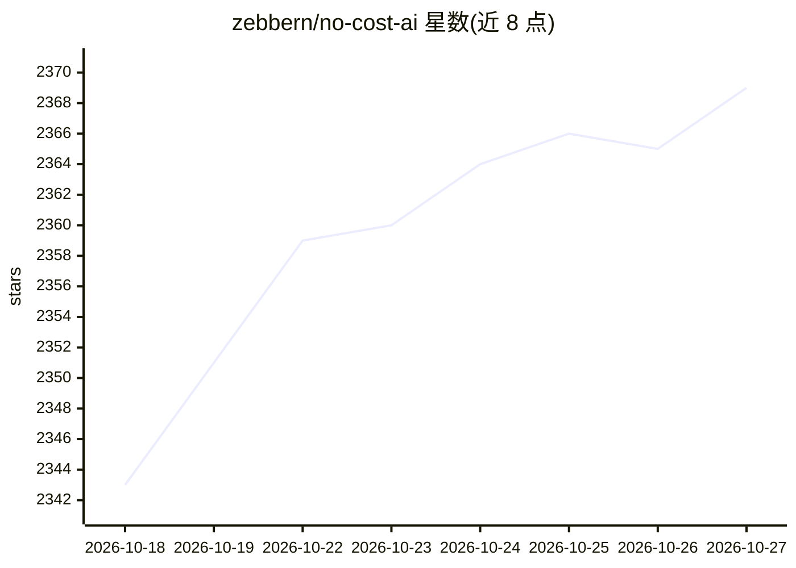

# zebbern/no-cost-ai

⭐ 2,369 · MIT · 推送 2026-09-21 · [GitHub](https://github.com/zebbern/no-cost-ai) · [官网](https://nocostai.vercel.app) · 个人维护 · 中文 README

**免费 AI 服务策展清单：80+ 项聊天/图像/语音/免费 API 入口**

面向开发者与研究者的免费 AI 资源聚合清单（living index），按“无需注册/需注册”与“聊天/媒体生成/语音/IDE/API”两个维度组织 80+ 个条目，每个条目列出可用模型与用量限制（如每日请求数、token 额度、水印与积分制）。另附 8 个模型排行榜链接（OpenRouter、Chatbot Arena、MTEB 等）。支持社区通过贡献添加条目，并对失效条目做移除标注。内容为外部站点索引，不含可运行代码。

## 筛选速览

| 维度 | 判定 | 备注 |
|---|---|---|
| AI 角色 | `ai-knowledge` | 知识聚合/清单类 |
| 许可风险 | `permissive` | MIT |
| 部署形态 | `None` |  |
| 模型依赖 | — | README 未给出锁定关系 |
| 硬件要求 | — | 无带数字的原话,不猜 |
| 安装摩擦 | `low` | 无编译、无系统依赖或容器化 |
| 成熟度 | — | 结构信号不足 |

## 能力要点

- 80+ 免费服务按注册要求与功能类别双维组织
- 每条注明免费模型与具体用量限制
- 附 8 个模型评测排行榜链接
- 对失效条目做移除标注（如 freegpt.es）

## 适用场景

- 寻找无需付费的聊天、图像、视频生成入口
- 查找免注册或免信用卡的 LLM API 渠道
- 通过排行榜了解各模型评测情况

## 场景标签

`精选清单` · 领域:学习与行业

## 证据(README 行号)

> L1: ### Spend 0$ on Ai-Models!
> L3: #### A living index for developers, researchers & curious builders contributions is welcome & appriciated!
> L11: |Topic|Links|

## 星数曲线

2026-10-18 2,343 → 2026-10-27 2,369（+26）

---
*卡片 v1 · prompt 1.4 · 生成 2026-10-21 · 置信度 high · 依据 README sha `ab8e43d272fb` · [字段定义](../../DATASET.md)*
