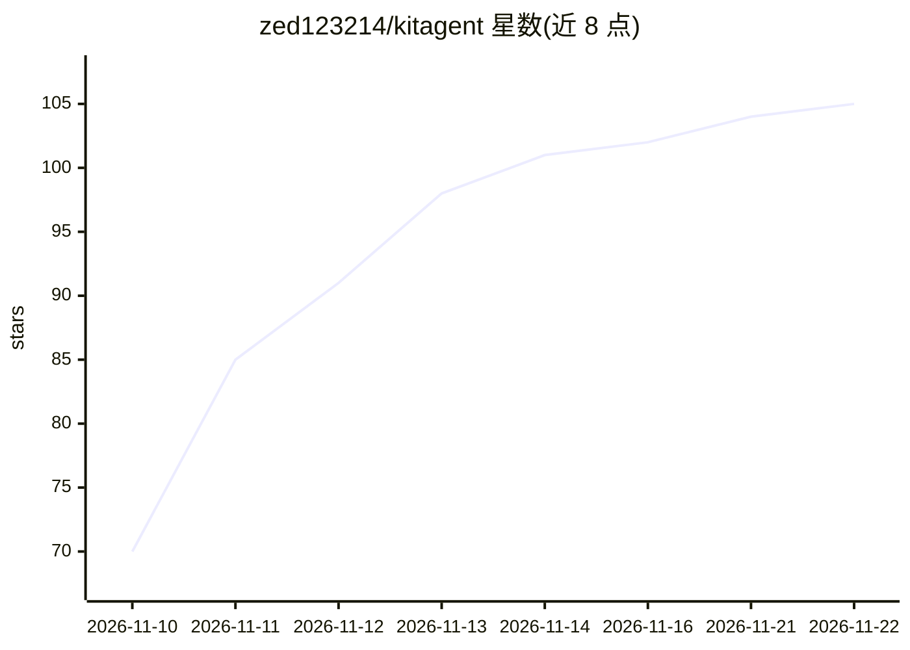

# zed123214/kitagent

⭐ 105 · Python · MIT · 推送 2026-11-20 · [GitHub](https://github.com/zed123214/kitagent) · [官网](https://github.com/zed123214/kitagent) · 个人维护 · 中文 README

**面向算子开发与性能优化的开源 Coding Agent 运行时与可视化工作台**

KitAgent 是开源 AI Agent 运行时与可视化工作台，面向想使用、学习或扩展 AI Agent 的开发者。用户对话式提交开发任务，Agent 阅读代码、修改文件、执行命令；工作台提供实时工具时间线、人工审批（只读/按需询问/自动批准）、会话记忆与报告导出。核心机制包括 Loop/LangGraph 双执行引擎、Graph+SQLite 检查点持久化恢复、Markdown Skills/MCP/Subagents 扩展，以及按会话创建 Pod 的 Kubernetes 沙箱（含资源限制与空闲回收）。模型接入目前为 Anthropic Provider，Web 工作台需 Node.js 构建前端，提供无 API Key 的离线演示路径。README 以算子（Equal、SparseFlashAttentionGrad）优化为示例场景。

## 筛选速览

| 维度 | 判定 | 备注 |
|---|---|---|
| AI 角色 | `ai-ecosystem` | LLM/agent 周边工具 |
| 许可风险 | `permissive` | MIT |
| 部署形态 | `None` |  |
| 模型依赖 | locked-api |  |
| 硬件要求 | — | 无带数字的原话,不猜 |
| 安装摩擦 | `low` | 无编译、无系统依赖或容器化 |
| 成熟度 | — | 结构信号不足 |

## 能力要点

- Web 工作台 / CLI / Textual TUI 三种入口共用同一 Core 运行时协议
- Loop 与 LangGraph 双引擎；Graph+SQLite 支持检查点保存、审批中断与重启续跑
- 按会话组织的 Kubernetes 沙箱：Pod 按需创建、资源限制、空闲回收，实测 p95 冷启动 3.52s
- Skills / MCP / Subagents 三类扩展机制，事件记录保存为 events.jsonl 支持回放

## 适用场景

- 把算子开发与性能优化任务交给 Agent，逐轮审批工具调用并导出开发报告
- 在可视化工作台中学习 AI Agent 的执行链路、审批与持久化恢复实现
- 通过 Skills、MCP 与 Subagents 扩展自己的开发工作流
- 用 Kubernetes 沙箱为每个会话提供隔离的命令执行与文件操作环境

## 场景标签

`Agent 框架` `编码 Agent` · 领域:Agent 开发

## 证据(README 行号)

> L5:  开源 AI Agent 运行时与可视化工作台
> L178: 在 **Web 工作台**中对话、审批和查看报告，在 **CLI** 中提交任务与接入脚本，在 **Textual TUI** 中进行终端交互。三种入口共用运行时协议，任务执行和会话状态由 Core 管理。
> L200: 默认 **Loop** 引擎运行模型与工具循环；可选 **LangGraph** 引擎提供显式节点编排。启用 **Graph + SQLite + Local** 后，可保存执行检查点与审批中断，在 Core 重启后续接任务，并

## 星数曲线

2026-11-10 70 → 2026-11-22 105（+35）

---
*卡片 v1 · prompt 1.4 · 生成 2026-11-17 · 置信度 high · 依据 README sha `a85a44e8cbdd` · [字段定义](../../DATASET.md)*
