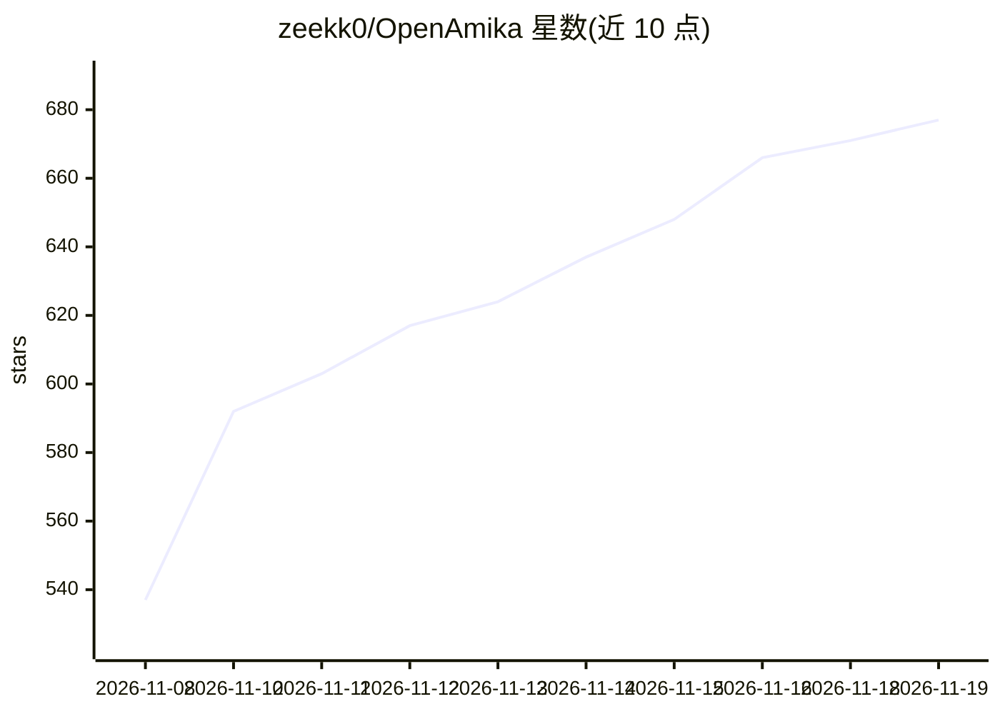

# zeekk0/OpenAmika

⭐ 677 · Python · NOASSERTION · 推送 2026-11-10 · [GitHub](https://github.com/zeekk0/OpenAmika) · [官网](https://www.mekahime.com/openamika) · 组织维护 · 中文 README

**开源 Live2D AI 陪伴角色：实时语音、长期记忆、本地运行**

MekaHime 开源的 Live2D 动漫角色 Amika，与用户进行实时语音和文字对话，具备长期记忆（memory_f、brain\memories，更新时自动备份）、所在城市设定与可选摄像头视觉（camera eyes）。语音、记忆等部件在本地运行，语言模型经 OpenRouter（Semi-Local）或 Ollama（Fully Local，建议 27B 以上）接入。面向 Windows 消费者用户：7 步安装（git clone + PowerShell 脚本，下载约 16 GB、占用约 40 GB 磁盘），需 NVIDIA RTX 20 系以上显卡（8 GB VRAM 起步）与 Python 3.11；另有托管版 mekahime.com/amika 可在浏览器使用。

## 筛选速览

| 维度 | 判定 | 备注 |
|---|---|---|
| AI 角色 | `ai-native` | 本体是模型或模型工具 |
| 许可风险 | `permissive` | NOASSERTION |
| 部署形态 | `desktop` | 安装包/桌面程序 |
| 模型依赖 | local-ok | 支持本地模型 |
| 硬件要求 | — | 无带数字的原话,不猜 |
| 安装摩擦 | `medium` | 含编译或系统依赖之一 |
| 成熟度 | — | 结构信号不足 |

## 能力要点

- Live2D 形象 + 实时语音/文字对话与长期记忆
- 语言模型可选 OpenRouter（Semi-Local）或本地 Ollama（Fully Local，建议 27B+）
- 更新脚本自动备份记忆与设置
- 提供浏览器托管版，无显卡用户可在线使用

## 适用场景

- 在自己的 Windows PC 上与 AI 陪伴角色语音对话
- 选择全本地 Ollama 方案保证数据不出本机
- 通过 OpenRouter 低成本使用托管模型运行角色

## 场景标签

`语音 Agent` `AI 助手` · 领域:对话与助手

## 证据(README 行号)

> L196: Amika is a Live2D anime girl who talks with you by voice and text in real time, remembers you, and lives with you
> L197: in your city. She runs on your own PC, with OpenRouter or fully local with Ollama. A hosted version runs at

## 星数曲线

2026-11-08 537 → 2026-11-19 677（+140）

---
*卡片 v1 · prompt 1.4 · 生成 2026-11-17 · 置信度 mid · 依据 README sha `b0791a705ed7` · [字段定义](../../DATASET.md)*
