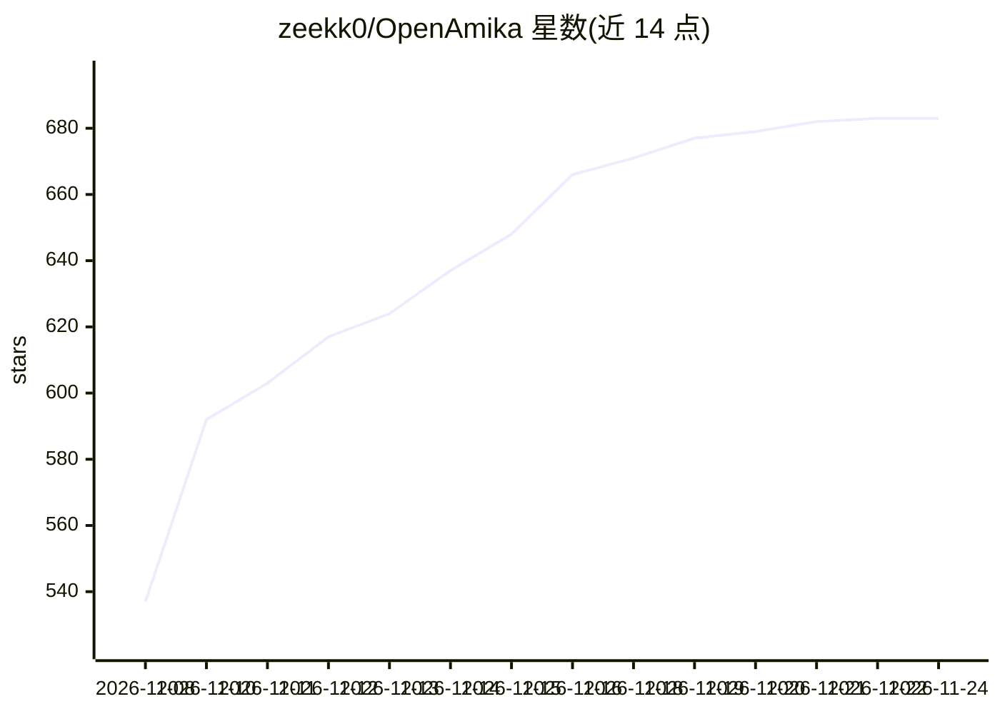

# zeekk0/OpenAmika

⭐ 684 · Python · NOASSERTION · 推送 2026-11-21 · [GitHub](https://github.com/zeekk0/OpenAmika) · [官网](https://www.mekahime.com/openamika) · 个人维护 · 中文 README

**给个人用户的本地 Live2D AI 伴侣：语音对话+长期记忆**

开源的 Live2D AI 伴侣应用：动漫形象通过语音与文字实时对话，具备长期记忆（memory_f、brain/memories），运行在用户自己的 Windows PC 上。语言模型两种方式：通过 OpenRouter API key 的半本地模式，或用 Ollama 全本地运行（要求 27B 以上模型）。语音识别、TTS、记忆与摄像头眼睛均在本地 GPU 运行（约 5.5 GB VRAM 起）。通过 PowerShell 脚本安装，含更新脚本并保留记忆备份，另有 mekahime.com/amika 托管版。

## 筛选速览

| 维度 | 判定 | 备注 |
|---|---|---|
| AI 角色 | `ai-native` | 本体是模型或模型工具 |
| 许可风险 | `permissive` | NOASSERTION |
| 部署形态 | `desktop` | 安装包/桌面程序 |
| 模型依赖 | local-ok | 支持本地模型 |
| 硬件要求 | — | 无带数字的原话,不猜 |
| 安装摩擦 | `medium` | 含编译或系统依赖之一 |
| 成熟度 | — | 结构信号不足 |

## 能力要点

- Live2D 形象实时语音/文字对话，本地运行
- 长期记忆存储与更新备份机制（Update 脚本自动备份）
- OpenRouter 或 Ollama 两种语言模型接入方式
- 安装器分步引导，含常见错误排查说明

## 适用场景

- 在自己的 Windows 电脑上运行一个有记忆的 Live2D 语音伴侣
- 无合适显卡时使用浏览器托管版对话
- 用 Ollama 本地大模型实现完全离线运行

## 场景标签

`语音 Agent` `AI 助手` `聊天机器人` · 领域:对话与助手

## 证据(README 行号)

> L196: Amika is a Live2D anime girl who talks with you by voice and text in real time, remembers you, and lives with you
> L224: Her ears, voice, memory and eyes always run on your PC. Her language model, the part that thinks and writes her
> L230: - **Fully Local**: on your PC with Ollama. Use a model of **27B parameters or more**; **70B or

## 星数曲线

2026-11-08 537 → 2026-11-24 683（+146）

---
*卡片 v1 · prompt 1.4 · 生成 2026-11-24 · 置信度 mid · 依据 README sha `224229c67b01` · [字段定义](../../DATASET.md)*
