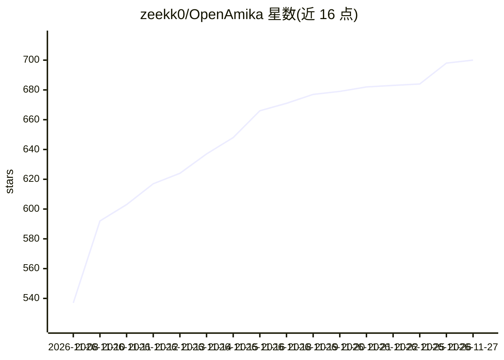

# zeekk0/OpenAmika

⭐ 700 · Python · NOASSERTION · 推送 2026-11-26 · [GitHub](https://github.com/zeekk0/OpenAmika) · [官网](https://www.mekahime.com/openamika) · 个人维护 · 中文 README

**给个人用户的 Live2D 实时语音 AI 伴侣，本地 PC 运行**

开源的桌面 AI 伴侣 Amika：Live2D 动漫形象，通过语音与文字实时对话，具备长期记忆（memory_f 与 brain\memories 目录）并感知用户所在城市。语音识别、记忆与语音合成在本地运行；语言模型走 OpenRouter 付费 API（Semi-Local）或本地 Ollama（推荐 27B 以上模型）。仅支持 Windows 10/11，要求 NVIDIA RTX 20 系以上显卡（8 GB 显存），完整安装约 37 GB 磁盘；提供 7 步安装脚本、更新脚本与托管网页版。

## 筛选速览

| 维度 | 判定 | 备注 |
|---|---|---|
| AI 角色 | `ai-native` | 本体是模型或模型工具 |
| 许可风险 | `permissive` | NOASSERTION |
| 部署形态 | `desktop` | 安装包/桌面程序 |
| 模型依赖 | local-ok | 支持本地模型 |
| 硬件要求 | — | 无带数字的原话,不猜 |
| 安装摩擦 | `medium` | 含编译或系统依赖之一 |
| 成熟度 | — | 结构信号不足 |

## 能力要点

- Live2D 形象 + 实时语音对话 + 长期记忆
- 语言模型可选 OpenRouter API 或本地 Ollama（27B 以上）
- Windows 一键安装/更新/停止脚本，更新前自动备份记忆
- 提供浏览器托管版（mekahime.com/amika）

## 适用场景

- 在我的 Windows PC 上养一个会记住我的 Live2D 语音伴侣
- 用 Ollama 在本地完全离线跑她的大脑
- 不想装本地环境时直接在网页上和她聊

## 场景标签

`语音 Agent` · 领域:对话与助手

## 证据(README 行号)

> L196: Amika is a Live2D anime girl who talks with you by voice and text in real time, remembers you, and lives with you
> L224: Her ears, voice, memory and eyes always run on your PC. Her language model, the part that thinks and writes her
> L227: - **Semi-Local (recommended)**: through OpenRouter on your own key. In almost all cases

## 星数曲线

2026-11-08 537 → 2026-11-27 700（+163）

---
*卡片 v1 · prompt 1.4 · 生成 2026-11-26 · 置信度 mid · 依据 README sha `f7e4112e3a15` · [字段定义](../../DATASET.md)*
