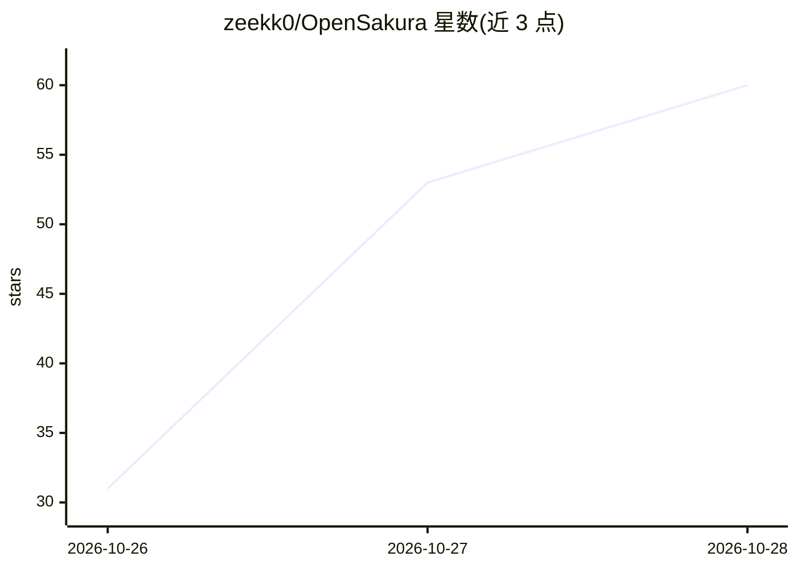

# zeekk0/OpenSakura

⭐ 60 · Python · NOASSERTION · 推送 2026-10-25 · [GitHub](https://github.com/zeekk0/OpenSakura) · [官网](https://www.mekahime.com/sakura) · 个人维护

**开源 3D 虚拟 AI 伴侣：语音对话、情绪状态与本地语音合成**

MekaHime 的原型 AI 伴侣，以 FastAPI 后端驱动：本地 STT（改版 SenseVoiceSmall）识别语音，OpenRouter 或 Ollama 作为大脑（四个 LLM 角色），本地 TTS（GPT-SoVITS 构建）合成语音；维护 26 种情绪状态、好感度与逐用户记忆，并通过动作链驱动 three.js VRM 化身在网页场景中表演。面向 18+ 用户，语音模式需 Windows 10/11 与 NVIDIA RTX GPU（16 GB VRAM 推荐），也提供纯文本模式（任意 OS、无 GPU）。语音模型按个人使用许可分发，接受许可后安装；声明为遗留原型，Discord 模式尚未可用。

## 筛选速览

| 维度 | 判定 | 备注 |
|---|---|---|
| AI 角色 | `ai-native` | 本体是模型或模型工具 |
| 许可风险 | `none` | NOASSERTION |
| 部署形态 | `desktop` | 安装包/桌面程序 |
| 模型依赖 | local-ok | 支持本地模型 |
| 硬件要求 | `gpu-8g` | |
| 安装摩擦 | `medium` | 含编译或系统依赖之一 |
| 成熟度 | — | 结构信号不足 |

## 能力要点

- 语音对话全链路：本地 STT → OpenRouter/Ollama 大脑 → 本地 GPT-SoVITS TTS
- 26 种情绪状态、好感度与逐用户记忆，随情绪语音回复并驱动化身动作
- 三种运行模式：全本地（Ollama）、半本地（OpenRouter + 本地语音）、纯文本
- three.js VRM 化身，GLB/FBX 动作剪辑可重定向到任意 VRM

## 适用场景

- 在网页中与带 3D 化身的 AI 伴侣语音或文字对话
- 用自己的 NVIDIA GPU 全本地运行，语音与大脑都不出本机
- 无 GPU 环境下用 OpenRouter 以纯文本模式运行

## 场景标签

`语音 Agent` `语音合成` · 领域:对话与助手

## 证据(README 行号)

> L9: Sakura is MekaHime's first prototype companion — a mood, a memory, a voice and a body —
> L27:  you ──mic──▶ STT (MekaHime-modified SenseVoiceSmall, local) ──▶ Sakura brain ──▶ TTS (MekaHime build of GPT-SoVITS
> L50: |**Fully local** (100% free)|Ollama, `qwen3:8b`|on your GPU|Windows 10/11 (Linux untested), NVIDIA RTX, 16 GB VRAM 

## 星数曲线

2026-10-26 31 → 2026-10-28 60（+29）

---
*卡片 v1 · prompt 1.4 · 生成 2026-10-26 · 置信度 mid · 依据 README sha `5649e9ddc071` · [字段定义](../../DATASET.md)*
