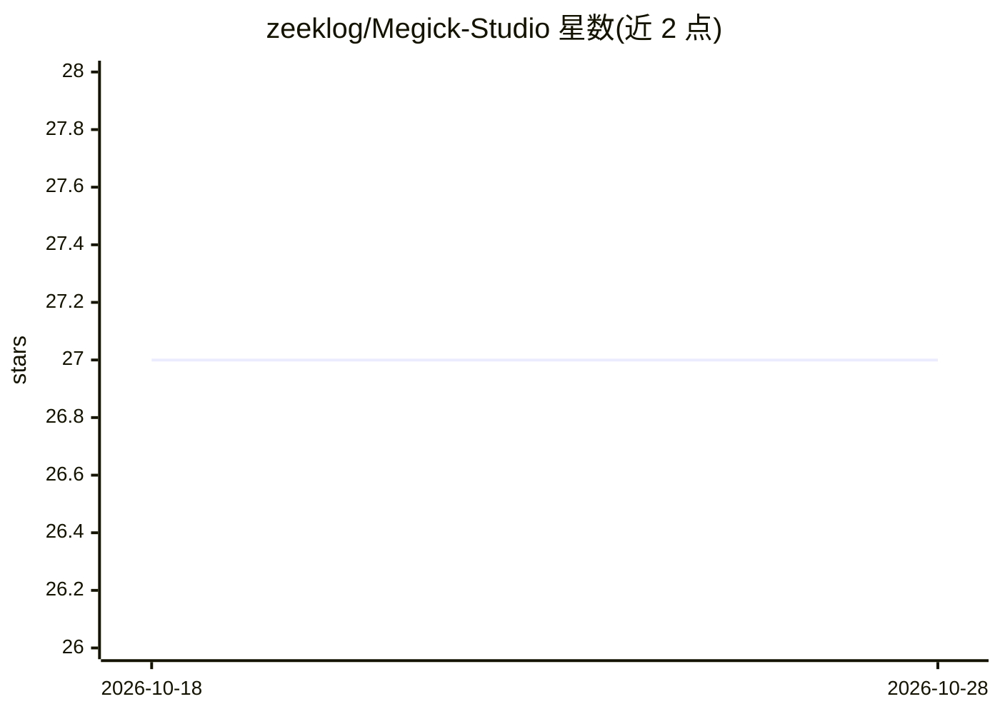

# zeeklog/Megick-Studio

⭐ 27 · TypeScript · NOASSERTION · 推送 2026-07-17 · [GitHub](https://github.com/zeeklog/Megick-Studio) · [官网](https://megick.com) · 组织维护 · 中文 README

**自托管 AI 图片/视频生成创作平台，支持 100+ 模型接入**

将 AI 图片生成（文生图、参考图生成、图片编辑）、AI 视频生成（文生视频、图生视频）、模板中心、媒体资产管理、浏览器端视频剪辑（MegickCut）、积分系统与管理后台整合为一套可私有部署的创作工作区，供团队搭建私有 AIGC 生产环境或二次开发。技术栈为 TanStack Start/React 19 前端 + NestJS 11/Prisma/MySQL 8/Redis 后端，存储默认阿里云 OSS（可选 Cloudflare R2），提供商协议仅持久化 OPENAI 与 ALIYUN 两种 API 风格，需 Node.js 22 与 pnpm 从源码运行，积分系统不含在线购买流程。

## 筛选速览

| 维度 | 判定 | 备注 |
|---|---|---|
| AI 角色 | `ai-native` | 本体是模型或模型工具 |
| 许可风险 | `none` | NOASSERTION |
| 部署形态 | `library` | 以包/库形式分发 |
| 模型依赖 | — | README 未给出锁定关系 |
| 硬件要求 | — | 无带数字的原话,不猜 |
| 安装摩擦 | `low` | 无编译、无系统依赖或容器化 |
| 成熟度 | — | 结构信号不足 |

## 能力要点

- 文生图/参考图/图片编辑与文生视频/图生视频生成工作流
- MegickCut 浏览器端视频剪辑（时间线、字幕、导出）
- 统一媒体中心，支持 OSS/R2 存储引用
- 管理后台覆盖用户、角色、模型、提供商、模板、队列与审计日志
- Electron 桌面封装

## 适用场景

- 团队搭建私有的 AI 图片/视频生成生产环境
- 统一管理生成结果、用户上传与模板素材
- 在自有站点上运营带积分与审核的 AIGC 创作服务

## 场景标签

`图像生成` `视频生成` · 领域:内容生成

## 证据(README 行号)

> L19: Megick Studio brings AI image generation, AI video generation, media asset management, template operations, model p
> L39: - AI image studio: text-to-image, reference-image generation, image editing, and common creative workflows.
> L40: - AI video studio: text-to-video and image-to-video, controlled by site settings.

## 星数曲线

2026-10-18 27 → 2026-10-28 27（+0）

---
*卡片 v1 · prompt 1.4 · 生成 2026-10-26 · 置信度 mid · 依据 README sha `0e75ec3a08ba` · [字段定义](../../DATASET.md)*
