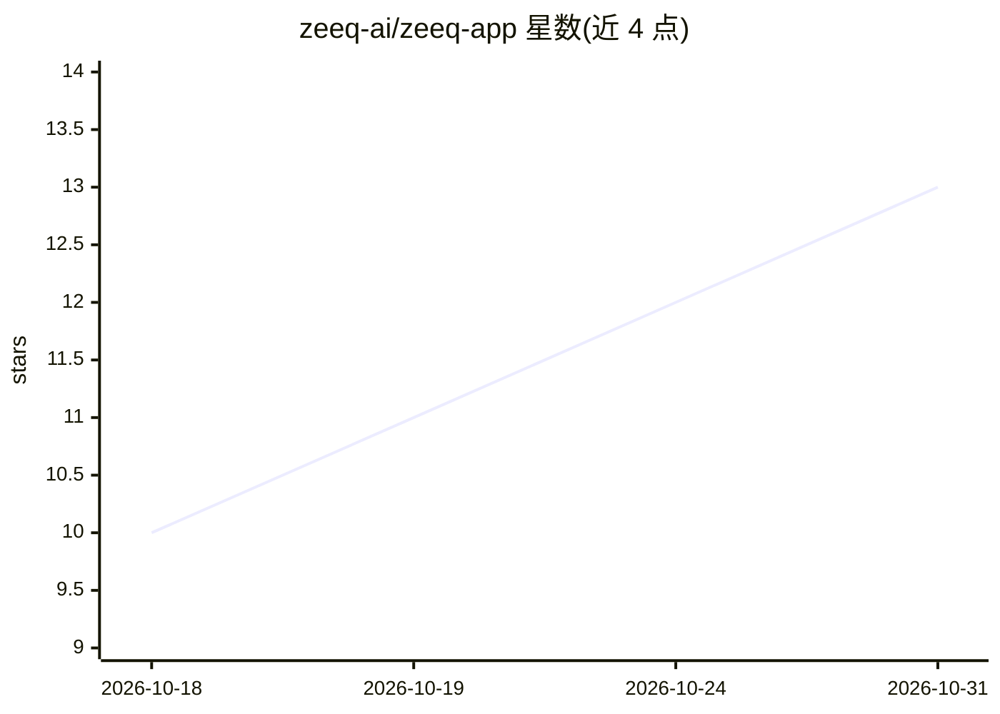

# zeeq-ai/zeeq-app

⭐ 13 · C# · AGPL-3.0 · 推送 2026-10-22 · [GitHub](https://github.com/zeeq-ai/zeeq-app) · [官网](https://zeeq.ai) · 组织维护

**面向团队的开源 MCP 遥测服务器：追踪 agent 上下文使用情况**

Zeeq 是一个自托管 MCP 服务器，提供 agent 上下文中哪些内容被激活与使用的遥测可见性，帮助团队观察 agent 如何利用上下文影响代码编写。同一套上下文溯源与遥测机制也应用于可在 agent 循环内（而非 CI 中）调用的代码评审。技术栈可完全运行在 Postgres 上，无需额外基础设施；最初是 Motion 公司（YC 孵化、C 轮）内部平台，服务 40+ 工程师团队，现已开源。本地通过 Mise 安装运行时并启动（GCP Pub/Sub 或 AWS 模拟器），支持 GCP 部署。

## 筛选速览

| 维度 | 判定 | 备注 |
|---|---|---|
| AI 角色 | `ai-ecosystem` | LLM/agent 周边工具 |
| 许可风险 | `viral` | AGPL-3.0 |
| 部署形态 | `None` |  |
| 模型依赖 | — | README 未给出锁定关系 |
| 硬件要求 | — | 无带数字的原话,不猜 |
| 安装摩擦 | `low` | 无编译、无系统依赖或容器化 |
| 成熟度 | — | 结构信号不足 |

## 能力要点

- MCP 服务器形式提供 agent 上下文激活与使用遥测
- 遥测机制同样应用于 agent 循环内的代码评审
- 可完全运行在 Postgres 上，自托管，无需额外基础设施
- 源自 Motion 内部 agentic coding 平台，已开源

## 适用场景

- 团队观察 AI 编码 agent 实际调用了哪些知识内容
- 在 agent 循环内而非 CI 环节进行代码评审
- 自托管 agent 知识层并收集使用遥测

## 场景标签

`代码审查` `LLM 可观测性` · 领域:编码与开发

## 证据(README 行号)

> L5: Zeeq ("zeek") is an MCP server that provides teams with visibility into which content is being activated and used in
> L11: The same context origin and telemetry are applied to code reviews which can be invoked *in the agent loop* (versus 
> L13: It is designed to be self hostable, relatively consolidated on a few technologies (can run entirely on Postgres; no

## 星数曲线

2026-10-18 10 → 2026-10-31 13（+3）

---
*卡片 v1 · prompt 1.4 · 生成 2026-10-31 · 置信度 high · 依据 README sha `28ce060d0b99` · [字段定义](../../DATASET.md)*
