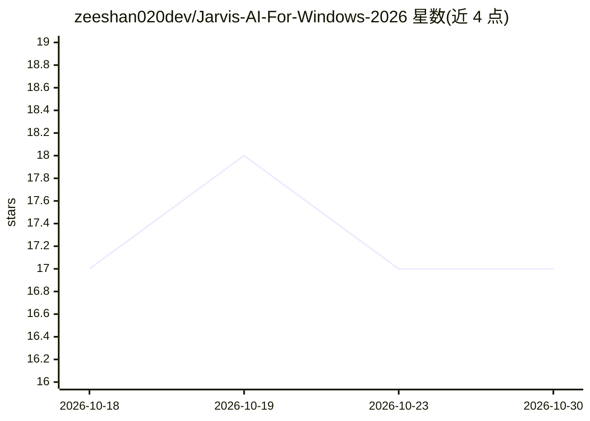

# zeeshan020dev/Jarvis-AI-For-Windows-2026

⭐ 17 · Python · 推送 2026-09-06 · [GitHub](https://github.com/zeeshan020dev/Jarvis-AI-For-Windows-2026) · 个人维护

**Windows 语音控制的 Gemini 桌面 AI 助手：语音对话与系统操作**

基于 Python 的 Windows 语音助手：通过麦克风采集语音命令，经 SpeechRecognition 识别后调用 Google Gemini（gemini-2.5-flash）生成回答，用 pyttsx3 朗读输出；同时支持打开网站、播放本地音乐、打开文件夹、报时等系统自动化操作，并保存较长的 AI 回复。需自备 Gemini API Key、麦克风与联网，以 python main.py 运行，无打包安装程序。

## 筛选速览

| 维度 | 判定 | 备注 |
|---|---|---|
| AI 角色 | `ai-native` | 本体是模型或模型工具 |
| 许可风险 | `none` | — |
| 部署形态 | `library` | 以包/库形式分发 |
| 模型依赖 | — | README 未给出锁定关系 |
| 硬件要求 | — | 无带数字的原话,不猜 |
| 安装摩擦 | `low` | 无编译、无系统依赖或容器化 |
| 成熟度 | — | 结构信号不足 |

## 能力要点

- 语音输入 + Gemini 对话 + TTS 语音输出的完整链路
- 网站/本地音乐/文件夹打开等系统自动化命令
- 持久聊天记忆与 API 配额 429 错误的检测重试
- 长篇 AI 回复自动保存到本地文件夹

## 适用场景

- 用语音向 AI 提问并获得朗读回答
- 语音打开 Google/YouTube/Wikipedia 或播放本地音乐
- 在 Windows 桌面体验 JARVIS 式语音助手

## 场景标签

`语音 Agent` `AI 助手` · 领域:对话与助手

## 证据(README 行号)

> L7: - 🧠 Respond intelligently using **Google Gemini**
> L18: - **AI Conversations** powered by Google Gemini

## 星数曲线

2026-10-18 17 → 2026-10-30 17（+0）

---
*卡片 v1 · prompt 1.4 · 生成 2026-10-29 · 置信度 high · 依据 README sha `239dc557392f` · [字段定义](../../DATASET.md)*
